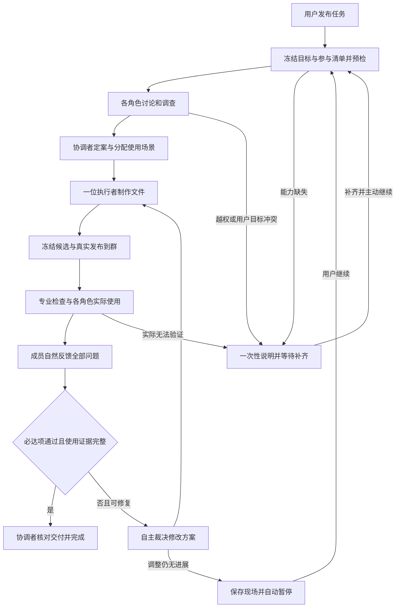

# 群聊自主工作模式详细设计

日期：2026-10-13。状态：已确认需求的实施设计，尚未接通或验收新增能力。新增工具和字段名称是建议，不是当前生产 API。

## 1. 已确认需求

| ID | 用户要求 | 可验收表达 |
|---|---|---|
| R01 | 发布一次任务，团队自主推进 | 自动讨论、定案、制作、使用、反馈、返工、复测，按完成条件交付 |
| R02 | 软件和文档都支持 | 软件实际运行并操作；文档检查渲染、排版、错别字和文案质量 |
| R03 | 优先 macOS App | 先完成 `.app` 真实操作验收；Windows 原生测试后续接入对应环境 |
| R04 | 每个 AI 真正使用产物 | 每个参与成员有自己的本轮操作或文档读取/视觉检查证据，不能只转述别人报告 |
| R05 | 不同角色使用不同场景 | 按职责分配场景，所有必达项有覆盖，不能分工后遗漏关键路径 |
| R06 | 拟人化讨论 | 沿用已有性格、说话习惯、关系和记忆，直接回应对方，自然表达分歧 |
| R07 | 每轮先用一位执行者 | 同一轮制作/修改由一人负责；多人分工和 subagent 式制作后续实施 |
| R08 | 系统选人，也允许用户指定 | 用户明确指定优先；资格和环境不足一次性说明，不能伪造资格 |
| R09 | 尽可能少问用户 | 一般实现和偏好分歧由协调者裁决；改变明确目标、越权或不可解决阻塞才提问 |
| R10 | 每次执行有文件产出 | 每轮有真实主产物及版本、使用报告；失败留存可用产物和诊断文件并如实标记 |
| R11 | 自动完成 | 已冻结必达验收全部通过、交付缺陷解决、全员使用完成后自动交付 |
| R12 | 不设预算 | 不新增任务累计费用/时长/轮次上限；显示累计用量，保留单次时限与空转保护 |
| R13 | 可暂停、停止，能告知空转 | 两入口可操作；有依据的疑似空转提示，自主调整仍无进展时自动暂停 |
| R14 | GitHub 技能与自动沉淀 | 群聊/私聊共用导入验证；实际成功流程可变成复用技能 |
| R15 | 视觉能力预检 | 承担界面/排版检查的角色须配置视觉模型，缺失统一提示，不自动换模型 |
| R16 | 接受本机可见测试 | Mac 窗口和焦点可短暂被操作，提供暂停；不要求第一阶段专用测试机器 |

第一阶段交付是可运行的 Mac 自主协作闭环及共享文档/技能能力。后续范围包括 Windows 和手机测试、远程环境、多执行者。普通聊天继续普通聊天；私聊共享工具、文档与技能能力，不凭空增加群成员，也不在本次改写其整套任务策略。

## 2. 能力边界和工程判断

范围明确、环境具备的软件和文档可以真实使用并自动迭代。当前实现不能直接满足全部要求，必须扩展工具、证据、状态和门禁。保留已有基础，预计是工作模式的中到大规模扩展，不是只调整话术，也没有依据要求重写整个应用。

实际操作通过测试说明该场景可用，不证明所有行为无缺陷。无法操作的自绘控件、缺失系统权限、登录或硬件依赖应成为有证据的阻塞。不得降低标准后宣称通过；用户明确豁免须标记为人工接受并保留未验证项。

## 3. 主流程



这是业务视图，不能直接为每个方框新增 Hive 状态枚举。优先映射已有 `clarifying/ready/producing/reviewing/delivered` 及任务暂停、停止状态；使用阶段作为当前审查阶段内的版本化子状态。

## 4. 人员、职责与自主裁决

### 4.1 参与清单

任务启动时枚举当前群有效 AI 成员，冻结参与清单。预检角色配置、模型、凭据、职业、工具权限及场景可执行性。不能因为现有选人器只选相关团队，就悄悄把“全员使用”缩为三个人使用。

无模型、停用、无适合执行者等情况统一列出。无法履行使用责任的成员不能被标记完成；用户明确调整参与范围后递增团队版本。群人数、同名成员及显式委托按真实 ID 处理。普通聊天的静音/回复配额不自动构成工作责任的豁免；需核对现有调用语义并在任务清单明确记录排除原因。

角色职业决定关注点，不给非开发角色虚构编程资格。普通用户视角角色也可分配真实基础使用场景。负责视觉检查的角色须有视觉模型，其他角色可通过真实控件、结果文件或文案阅读验证自己的职责。

### 4.2 单制作执行者与多个试用者

`executorId` 是当前轮制作责任人；实际正在调用工具的 `actorId` 可以是试用成员。不能为了切换试用者改写用户委托。每位成员自己的模型决定自己的操作和反馈，公共运行器可以共用，但会话、数据和证据归属必须区分。

一位制作执行者可以写源码、测试脚本和必要材料；其他角色当前轮可以调查和试用，不能并发修改候选或测试断言。下一轮系统可按问题重新选合格执行者；用户钉定执行者时必须遵循，资格丢失先说明，不能暗中改派。

### 4.3 一般分歧由协调者处理

| 问题 | 谁处理 | 必要证据 |
|---|---|---|
| 同范围内技术路线、布局、命名等取舍 | 协调者 | 成员观点、可行性、与目标的关系、选择理由 |
| 必达功能的可复现失败 | 执行者修复，实际复测 | 失败操作、预期/实际、当前候选摘要 |
| 一般偏好分歧，必达标准已通过 | 协调者可以定案 | 保留反对意见和决定理由，不代写认可 |
| 修改用户明确格式、目标、指定人员或扩大范围 | 用户 | 原要求、拟改动、影响和必要原因 |
| 越过授权、系统级安装、发布、登录或外部不可逆操作 | 用户/平台授权入口 | 实际能力/授权缺口 |
| 自动调整仍无法验证或持续无进展 | 自动暂停，必要时用户处理 | 已尝试方法、当前产物和阻塞条件 |

不能仅在提示词中说“自主拍板”。现有 `_approve` 的反对即用户裁决、`_allApproved` 和问题解决规则也必须改成有明确授权的策略。建议新增版本化 `autonomyPolicy`，由应用根据用户配置固化，模型无权开启。

新策略下方案门禁要求所有成员有真实意见、争议有有效处理、协调者有真实决议，而非把所有人的 `approved:false` 变成 true。交付要求客观验收通过及全员使用完成；可保留已裁决的偏好分歧。实质失败不能被协调者豁免为通过。

原有用户决策与协调决策必须区分来源；只读旧记录时维持旧语义。不能把模型回应写为 `sourceRole=user`，也不能伪造其他成员签字。范围变化仍须用户明示；普通实现细化可以在范围内定案，无需每次递增用户需求版本。

协调决议必须来自当前 `coordinatorId` 的实际请求-响应，绑定当前需求/团队版本和被处理问题；外部协作增量或其他成员不能冒用协调身份。新策略字段缺失按旧策略读取，未知策略版本阻塞，不能从模型提案推导用户已授予自主决策权。

## 5. 每个角色真正使用的合同

### 5.1 使用计划

在方案中固化 `usageAssignments`：成员 ID、场景 ID、目标、前置数据、步骤目标、预期结果、必达验收 ID、所需能力、测试数据重置方式。具体动作由该成员根据当前观察选择，而不是让一个代理演出全体成员的操作。

计划需要覆盖“每个成员至少一个有意义场景”和“全部必达验收有覆盖”；专业回归可以另有自动测试。每个成员都读取同一文件的同一行、打开窗口后立即关闭，不构成不同场景的使用。

| 示例角色 | Mac 记账 App 的使用场景 | 文档的使用场景 |
|---|---|---|
| 开发 | 编辑金额、重启、核对持久化及错误日志 | 核对技术术语、步骤和内容一致性 |
| 测试 | 空值、边界金额、导入导出、回归缺陷 | 错别字、编号、交叉引用与遗漏 |
| 设计 | 实际缩放窗口、切换界面，观察遮挡和布局 | 实际查看分页、表格、图文关系及样式 |
| 产品/用户视角 | 新建账目至导出的日常完整流程 | 阅读文案，检查自然程度、歧义与空泛表达 |

### 5.2 工具产生的使用收据

建议由应用生成下列证据结构；模型只能引用 `receiptId`，不能填写有效收据来宣称执行。这里是新合同示意，不可直接给当前解析器发送。

```json
{
  "schemaVersion": 1,
  "receiptId": "runtime-generated-id",
  "taskId": "task-id",
  "conversationId": "group-id",
  "actorId": "member-id",
  "requestRevision": 1,
  "teamRevision": 1,
  "iterationId": "candidate-id",
  "artifactDigest": "sha256-of-candidate",
  "scenarioId": "assigned-scenario-id",
  "sessionRef": "runtime-owned-session",
  "runtime": "macos-native",
  "operation": "click",
  "inputRef": "validated-operation-input",
  "observationBeforeRef": "observation-id",
  "observationAfterRef": "observation-id",
  "outputRefs": ["screenshot-id", "result-file-id"],
  "status": "succeeded",
  "startedAt": "2026-10-13T01:00:00Z",
  "finishedAt": "2026-10-13T01:00:01Z"
}
```

有效性至少核验：任务/成员/场景绑定、所有版本、真实工具调用、候选身份、操作前后观察、结果文件存在和摘要。`toolSucceeded` 仅表示操作成功，不能等同于场景验收通过。截图存在也不能证明角色看过截图；必须有同一角色收到相应图像的模型请求记录和该角色的实际反馈引用。

权威收据在应用管理的证据存储中创建，通用文件写入和技能脚本不能把任意 JSON 登记为有效 receipt。模型生成的报告是解释材料，需由运行时对照自己的调用记录核验。当前方案提供应用层证据来源校验，不声称能抵抗同一操作系统用户权限下任意恶意本机进程篡改；更强隔离需要专用环境。

角色反馈包含自己的真实结果、全部新缺陷、复现步骤、预期与实际、建议和证据引用。未操作只能说准备检查；没有模型正文不能伪造该角色结论。允许共享证据交流，但别人的报告不算自己的使用收据。

### 5.3 完成门禁

唯一完成判断同时要求：当前方案有效、当前候选可验证、必达验收全部通过、交付缺陷有实际复测、所有参与成员已完成当前使用计划、反馈与协调决议完整、待处理用户输入已处置、文件可交付。

新增使用证据必须接入生产完成守卫和 `deliveryReady`。只在面板勾选“已使用”、仅检查发言次数或模型自述，均不能满足 R04。改变候选摘要后旧证据失效；首版保守地对所有成员重新执行其场景，不提前实现复杂的局部失效推理。

## 6. macOS 原生应用

### 6.1 第一阶段必须现场验证

P0 在当前 Mac 验证：Xcode、Appium/Mac2 兼容版本、系统辅助功能/自动化权限、精确目标启动、控件树、截图、输入、点击、滚动、持久化和停止。以一个带确定性故障的小型 `.app` 做证据样本，再检查一个 Flutter `.app` 的关键控件可见性。

Appium Mac2 基于 XCTest，并支持 `appPath` 和 `bundleId`。[启动配置](https://github.com/appium/appium-mac2-driver/blob/master/docs/reference/capabilities.md)。这些能力支持采用该路线，但不替代现场验证。缺权限、缺 SDK 或目标无法操作时一次性列全，不使用默认 Finder 会话冒充被测应用。

### 6.2 窄范围工具适配

建议新增一个 `native.app` 工具，使用 `operation` 区分 open/observe/act/close。现有 Dio 连接应用管理的本地 Appium 服务，复用文件、审批、取消、事件和资源锁，不引入第二个 Agent 调度循环。

运行时根据当前候选选择 appPath/bundleId。模型不能指定 Appium 服务 URL、任意 bundleId、prerun/postrun AppleScript 或启用任意 shell 执行。服务只监听固定 loopback，确认属于本次管理的进程；不能默认开放到局域网。若使用已有 Appium 服务，需要显式绑定并确认身份。

仅在当前已授权的使用/验证执行段开放原生操作，方案讨论仍保留只读调查边界。工具登记虽然可复用一个名称，open/act/close 的副作用、observe 的读取范围和截图处理必须分别校验，不能因为观察是只读就绕过整套原生会话授权。

`observe` 返回目标窗口/可访问性树及受限截图；`act` 仅接受白名单的元素点击、输入、滚动、窗口调整和必要坐标操作。元素 ID 必须属于当前最新观察和该成员会话。操作前后验证目标进程与窗口；焦点被用户或其他进程夺走时先观察或暂停，禁止向未知前台窗口输入。

坐标操作必须保存截图尺寸、窗口位置、显示器和缩放比例，完成真实设备校准。原生画布需要视觉观察与坐标行为验证，不能将 DOM/控件树检查算为已试玩。屏幕采集优先限目标窗口；无法限制时提示一次可能包含其他窗口，不能把整个桌面内容作为常规模型上下文上传。

Mac2 的点击/滚动等基于 XCTest。[操作接口](https://github.com/appium/appium-mac2-driver/blob/master/docs/reference/execute-methods.md)。原生适配器调用这些能力并产收据；不得开放文档中所有方法来替代任务范围控制。

### 6.3 `.app` 包与交付身份

`.app` 是目录。先采取专门的应用包封装，不把现有所有 `File` API 泛化成任意目录系统：实际交付物仍为 `.app`，候选版本和聊天附件可用包含完整 `.app` 的 ZIP 作为传输载体。

合同须同时声明逻辑产物路径 `Demo.app` 和封装路径 `Demo-macos.zip`。建议候选元数据增加版本化 bundle 描述，记录包名、Info.plist 信息、可执行文件、包内树摘要、封装摘要及构建来源。对旧候选 schema=1 保持原读法，新 schema 明确解析，未知版本保留并阻塞。

树摘要按相对路径稳定排序，包含文件字节摘要、类型、可执行权限和内部符号链接目标；不跟随外部链接。拒绝越界路径、冲突文件名、特殊文件和解压炸弹。保留合法 Framework 内部链接及运行所需元数据，不直接复制成一个失去权限的文件目录。打包和解包后检查实际启动和签名状态，不能只核对 ZIP 头。

从冻结封装解包至已授权测试目录，启动这份 `.app`，记录实际进程路径与包内摘要。开始/结束试用都核对候选及测试包身份。测试数据放在独立可写目录，不能在冻结 bundle 内写入；若目标必须改写 bundle，证据应失效并明确说明。

App 的默认存储可能位于 Application Support 或 UserDefaults，不能只靠设 workingDirectory 就声称数据隔离。优先给本任务制作的软件提供可验证的测试数据入口；无法隔离的第三方程序先说明并使用专门环境。路径许可不是操作系统级沙箱，不能保证程序本身不会访问其他目录。

ZIP 是传输载体，不将“用户要 App”改成“用户只要压缩包”。交付 UI 明确显示包内应用及解包方式；合同仍核验真实 `.app`。用户明确要求 DMG 或特定路径时按原要求生成，不能静默更换。

### 6.4 串行桌面锁与控制

现有最大两个任务槽不变，但一台 Mac 的 GUI 操作只能有一个持有者。复用 `WorkResourceLockManager` 的设备级桌面资源，覆盖同会话及不同会话任务；另一任务可以讨论或等待，不同时抢鼠标焦点。

暂停停止应取消正在等待的模型/工具请求，禁止后续动作，尽力关闭本任务会话和测试进程，保留证据。无法确认进程已退出时显示清理未完成并保留桌面资源的阻塞标记，核对后再释放，不能把仍活动的桌面操作交给下一任务。

当前用户接受本机可见测试，不代表权限对所有应用或任意桌面内容通用。系统权限由用户在系统设置授予，模型不自动关闭系统认证。关闭群页面可以继续运行；退出 App 后按现有恢复规则中断，不能声称离线持续操作。

## 7. 网页和其他软件

网页/HTML 使用 Playwright 实际完成点击、输入和业务场景，记录操作追踪、断言、控制台异常和截图。[官方追踪说明](https://playwright.dev/docs/api/class-tracing)。在既有授权测试环境内运行，浏览器默认仍关闭，只有本任务明确授权时启用；默认限制本地待测站点及用户授权的来源。

命令行程序通过真实输入、输出、退出码、结果文件和重启行为验收。模型生成一份 tests JSON 仅是报告格式；可信运行器应将验收断言与真实执行、产物摘要和操作记录绑定，拒绝仅打印预期结果的假测试。

Windows 用实际 Windows 电脑/虚拟机运行原生测试；Android/iOS 用对应设备或模拟器。后续远程执行必须增加配对、认证、环境身份、加密传输、摘要核验和取消协议；本地审批收据不能跨设备当执行授权。首版只标能力可用性和未验证原因，不建设通用远程平台。

## 8. 文档视觉与文字检查

用户要求的文档使用重点是排版、错别字、错位和文案自然程度，不强制把每份报告付诸现实业务实施。

流程：冻结真实文档 -> 使用可用渲染器生成页图 -> 记录页数、引擎/版本、字体及文档摘要 -> 角色读取全文或其文字责任范围，并实际查看分配页图 -> 提出全部问题 -> 修改 -> 重新渲染检查。

PDF 优先直接渲染。DOCX/XLSX 优先使用已验证的本机 Office/LibreOffice 或现有转换能力；不要求同时装多套工具。LibreOffice 支持命令行运行和转换。[官方参数](https://help.libreoffice.org/latest/en-US/text/shared/guide/start_parameters.html)。跨引擎分页差异应记录；需要 Word 精确兼容时必须在 Word 环境验收。

建议 `workspace.document` 增加受控的 render 子能力，输出真实页图和 manifest，再复用已有图像附件管道。不另建通用在线文档编辑服务。输入是授权的当前文档，转换输出只在测试/证据目录，宏和自动外部资源访问关闭；不执行文档内嵌指令。

| 检查方向 | 验收证据 |
|---|---|
| 错位、重叠、截断、分页、表格跨页、图文关系 | 页图编号、区域、实际现象和修改建议 |
| 错别字、标点、术语、编号、引用 | 原文位置、原句和建议修改；不能无依据修改专有名词 |
| 文案自然程度 | 具体句段中的重复、套话、空泛形容、含糊主语及可读性问题 |
| 正文完整性 | 真实全文/分页读取覆盖，不能用搜索片段代表全文 |

“去 AI 化”落实为文案质量，不使用 AI 来源检测分数作完成门禁，不承诺改变文字的生成来源。编辑不得为了自然语气删除事实、关键数字、引用或用户约束。

长文档按页分批发送图片，遵循视觉模型和内联图片上限；清单需记录角色实际收到的页，不让页数膨胀导致截断或遗漏。所有必要页面最终有覆盖；成员可以按不同方向使用同一页，但每人的读取和模型反馈必须独立。渲染或模型能力缺失标为未验证，不能用正文解析代替视觉通过。

## 9. GitHub 技能及经验沉淀

### 9.1 现状和新增范围

当前 `skill.download` 只安装内置模板，`skill.create` 只保存指令元数据。保留内置模板入口，明确区分远程来源；新增 GitHub 导入要同时处理正文与引用资源。[Agent Skills 格式](https://agentskills.io/specification)包含 `SKILL.md` 及可选 scripts/references/assets，首版支持这一格式的安全子集，不宣称所有代理生态技能兼容。

### 9.2 发现与下载

优先级：已验证的本地技能 -> 内置匹配模板 -> 用户指定 GitHub 仓库 -> 受控 GitHub 发现 -> 确有新方法时创建。

生产搜索继续走 `gateway/` 的现有搜索入口。技能文件读取不能把任意 GitHub/搜索 URL 交给客户端通用 fetch；建议给网关增加固定 GitHub 上游的窄范围资源入口，由服务端按 owner/repo/path/commit 构造请求。客户端不能提供主机、IP、重定向目标或通用目标 URL。

首版支持公共仓库。私有 GitHub 认证暂作为后续范围；若新增凭据，必须经 `SecureStorageService`，不存入 app_settings、技能包或导出文件。保持既有 DNS/IP 固定、认证、限流、脱敏和熔断；受控文件下载不能把网关变成代理任意 URL 的服务。

导入时先把分支/标签解析为固定 commit，记录仓库、相对目录、许可来源、文件摘要和时间。按技能子目录获取 manifest 及被引用资源，不盲目下载整个仓库。限制数量、单文件和总体积，拒绝目录穿越、外链、非法 YAML、别名递归炸弹和外部符号链接。

### 9.3 验证与激活

状态建议：已获取/待验证 -> 可解析 -> 适用性测试通过 -> 已激活；失败保留原因及可重试入口。缺少 license 信息需明确标记，不能伪造许可。SHA 固定不是恶意检测保证，仍需执行边界。

外部正文和 `allowed-tools` 都是资料；它们不能扩大授权，也不能重新定义当前任务的验收。实际权限为角色已授权能力、任务授权和运行时策略的交集。脚本运行仍经现有命令策略；下载不执行安装脚本，读取不触发宏或外部命令。系统级依赖安装需要用户处理。

资源包位于应用管理的技能目录，模型通过按 packId/path 受限读取的技能资源接口访问，不能让 workspace.read 获得整个用户目录。按需加载正文与资源，不能把全部 GitHub 文件塞进每轮提示词。

最小模型扩展建议为 `CharacterSkill` 追加可空 `resourcePackId`（现有字段 0–8 不改），资源 manifest 保存来源、摘要、验证状态和资源清单。实际实现若能复用既有等价字段可调整，但不能仅把 URL 填进 description 后宣称完整资源包支持。修改 Hive 字段后必须生成 adapter。

已经预先授权的来源读取、技能目录变更和任务内验证可以连续执行；权限、来源范围或系统依赖越界才提问。需要将现有精确 skill mutation 守卫扩展为有边界的持续授权及可恢复写入，不能直接去掉当前两道校验。验证失败不激活，临时技能也不能自动全局启用。

### 9.4 何时自己创建技能

| 条件 | 处理 |
|---|---|
| 用户明确要求创建 | 生成草稿，验证实际流程后激活 |
| 本地、内置、受控 GitHub 查找均无适用项，存在真实方法缺口 | 先形成可验证草稿，完成代表性任务并复测，再保存为可复用技能 |
| 任务成功且使用了尚未覆盖的复用流程 | 去重后沉淀适用条件、步骤、依赖、失败路径及真实成功证据 |
| 网络失败、协议错误、权限不足、SDK 缺失 | 修复对应问题；创建说明不能补出工具能力 |
| 用户只说“继续”“附件呢” | 沿用任务上下文，不创建技能 |
| 仅换名称、语气或同一方法的重复描述 | 复用已有技能，避免技能膨胀 |

新技能不能将密钥、用户私有正文、临时绝对路径、登录状态或设备审批带入可复用资源。保留验证过的流程与输入输出边界；首次验证只证明其代表性场景，不证明通用正确性。资源发生改变或运行环境不匹配时重新验证。

群聊和私聊共用发现/导入/验证/加载。群任务由协调者安排具体角色，私聊使用原角色；技能成功不会改变原产物合同，也不替代文件交付。

## 10. 低打扰授权和用户输入

持续授权绑定任务、项目/目录、操作类别、目标应用/测试环境和必要来源。普通创建修改、构建、启动已核验产物、测试和证据写入可连续推进。用户撤销、任务删除、项目改绑或范围扩张时失效；重启重新核对本地授权，导入备份不携带执行权。

询问只用于真实必需信息、明确目标冲突、能力/权限缺口、无法解决阻塞及授权外操作。同一阻塞与版本复用提醒，一次列全环境缺项；可查代码、工具、资料和团队决定的问题先自行处理。模型不能以“需要用户确认方案”替代已授权的普通定案。

讨论中的补充进入新请求版本，过时模型返回不能推进状态。制作/使用中的输入持久 FIFO，按当前运行段安全收尾后处理，不取消旧任务并丢掉新请求。必需变更未处理前不得最终交付；明确修订仍覆盖原逻辑附件路径，测试脚本和分段源文件按各自路径写入。

若用户的输入触发明确撤销授权或紧急停止，走控制入口立即取消；普通后续修改按 FIFO。不能从任意附件文字推导“用户停止”。

## 11. 用量、空转和操作入口

### 11.1 用量

复用 `AiRequestGateway` 和设备本地账本。为讨论、制作、使用、协议修复、网络重试及任务摘要请求补齐可空 taskId/runBoundary 归属；旧记录无字段保持可读，不能按时间猜出准确归属。

按真实请求 ID 去重，重试按真实请求计费；`rootRequestId` 仅用于关联，不把所有重试折叠为一次消费。缓存输入是输入的一部分，不能重复加到总 token。展示累计输入/输出、请求数、各角色用量和已知费用；未知用量或价格标为未知/估算，不同币种分别显示，不显示伪精确的“0 元”。

UI 默认显示当前任务总量，可展开当前运行段和角色。保留当前可见统计摘要以应对账本清理，但不能另建费用账本；账本仍设备本地不进入跨设备备份。没有任务预算不意味着删除用户已有全局治理配置，遇到全局配置限制需说明真实来源。

### 11.2 空转

复用 `WorkProgressGuard` 当前证据指纹。现有门槛为相同条件连续失败 3 次、连续 8 个无进展结果；这是调整/暂停触发，不是任务预算。实施时先保留并用真实长任务校准，不新增另一套轮次配额。

进展包括有效新证据、实际缺陷定位、验收状态推进及与问题相关的真实修改。工具调用次数、换说法、重新创建同内容文件、盲目创建技能和重复截图不能无限重置进展。仅输出不同内容也不必然是朝验收推进，需要与未决问题关联；新事实并不等于已完成。

首次疑似空转时协调者检查真实失败、换一种有依据的方法；记录修复前提与计划，允许一次有边界的恢复尝试。相同条件再触发仍无进展则自动暂停。只是等待用户、排队、慢请求尚在产生输出不计空转。单次请求时限、网络有限重试和协议分块策略继续保留。

### 11.3 UI

群气泡显示角色自然对话；任务面板显示阶段、累计用量、当前产物版本、成员场景状态、真实证据入口、缺陷和空转依据。复用现有面板及 overlay，不增加营销式总览页。

暂停/继续、停止、查看文件、查看证据使用现有动作和熟悉图标；禁用状态显示真实原因。停止保留产物与检查点，继续沿用 `AgentTask.isUserStopped` 规则，不伪造从头重跑。原生操作期间显著显示正在控制的目标应用和本机暂停入口。

## 12. 人格和公开对话

当前 v2 已有 `rolePlaySystemPrompt`、统一记忆和 `replyGuidance`。先复用并检查真正发送的上下文，禁止因机械感再造普通聊天执行循环。沿用关系和有效心情，但它们不能降低验证责任或改变事实。

每回合给角色一个自然发言目标：回应某人疑问、提出真实新问题、反对取舍、说明操作发现、认可复测、承认失败等。先广泛征询，再围绕未决问题定向接话；不每轮按固定职业顺序点名，也不强制所有人重复“已收到、同意、开始执行”。每人的试用责任仍必须完成。

公开语句保持角色原风格，可以短、长、直率、谨慎、有适当情绪；不固定职业前缀、编号、理解百分比、协议字段或“结论/依据/行动”模板。复杂的全量问题写进结构化详情和附件，气泡指出关键发现并链接完整内容。

内部协议继续严格结构化。先优化按阶段裁剪和人格上下文，不默认拆成两次模型调用来写协议和表演对话。需要一次正文改写时不能增加事实、补造同意、删掉异议，使用现有有界改写和诊断机制；低质量表达不能让整条任务永久重试。

风格验收使用完整真实群聊样本，检查接话、差异、依据和自然程度；不能只用正则检查没有编号就宣称拟人化通过。自然对话示例和运行提示词见 `03-prompts.md`。

## 13. 持久化、恢复和安全

优先扩展现有协作 JSON、候选元数据和事件详情。建议新增数据只有 `autonomyPolicy`、使用计划、有效使用证据引用、协调裁决、必要能力预检与原生 bundle 描述；不建设通用工作流平台或新数据库。

完整收据和图像保存在任务/候选证据目录，检查点只存有界当前索引。按成员/场景/当前版本收口，历史证据保留于磁盘，不随迭代无限注入上下文。不能裁掉未决义务或让无效新字段将整条旧状态解析成可运行默认值。

必须覆盖 JSON 严格字段校验、checkpoint 保留字段、`toPromptJson`、上下文摘要、协作增量校验、面板与备份。旧终态不补造签字或使用证明；旧未完成任务显式继续后建立当前使用计划，已有文件保留。

UI 操作及导入变更前持久不确定标记，完成后写本地工具收据。重启不盲目重放点击、付款、安装或追加写。会话失效需要重新建立并核对目标/数据；无法证明上次动作是否完成时进入恢复决策，不能承诺普遍 exactly-once。

恢复和停止必须保持同会话串行、桌面锁、文件锁和迟到写入闸门。任务删除不删除用户产物；删除后原生运行器不再写回任务或重建事件日志。权限撤销后关闭会话，旧收据作为历史不能授权新动作。

技能资源包及文档/应用证据要按完整、配置、会话备份范围分别处理；新增资源引用需要 ID 重映射、缺文件提示和生命周期清理。新 `app_settings` 键同步 backup_setting_keys、snapshot、restore rewrite 和 data_lifecycle_settings。导入的技能验证和操作收据均不能跨设备沿用为本地权限。

凭据、截图中的无关隐私、环境秘密和私有推理不能进入公开日志或交付物。依照现有密钥扫描、路径授权和导出禁止字段处理。当前 macOS 凭据存储政策维持，不以本次设计顺带改存储体系。

## 14. 实施影响范围

以下是需要检查的调用链，不强制创建同名新类。编码前用 rg 定位实际调用者，完整列出需要更新的文件。

| 子系统 | 主要现有落点 | 联动范围 |
|---|---|---|
| 协作与裁决 | `work_collaboration_state*`、`work_discussion_v2_*`、coordinator collaboration update | 提案/成员协议、门禁、增量校验、历史兼容、签字与问题台账 |
| 单执行与成员试用 | `default_work_task_runner_production*`、`_review.dart`、`work_agent_loop*` | 角色身份、验证绑定、完成守卫、取消/恢复和 checkpoint |
| 原生及文档工具 | runner tools、`work_tool_registry`、`agent_decision_parser`、`tool_request`、`work_document_tool*` | 工具注册、参数校验、角色权限、实际运行时、锁和证据 |
| 原生包 | `work_candidate_publication`、`work_artifact_delivery_guard`、delivery/attachments | 包封装、摘要、文件格式、审查身份、附件和版本恢复 |
| 人格 | v2 session/request/context、`agent_prompt_builder`、已有 memory 入口 | 真正发送的 system/user 上下文、正文改写、事实规范 |
| 技能 | resolver/catalog/download service、runner skill mutations、`CharacterSkill` | 资源包、来源验证、授权、按需加载、角色绑定与生成 adapter |
| GitHub 上游 | `gateway/src/`、`features/web_search/` 的现有安全和 provider 接口 | 固定上游资源路由、受控发现、DNS/IP、认证和错误路径 |
| 用量 | governance gateway/models/store、各模型请求入口 | 请求归属、重试统计、币种、缺 usage、摘要和面板 |
| 控制与数据 | task panel/overlay、recovery/deletion、backup、data lifecycle | 跨页面、停止继续、删除、导入、资源清理及迁移 |
| 测试和发行 | `test/work_mode/`、agentic/document/governance/backup 现有测试、macOS 构建 | 回归、真实环境验收、运行时依赖检查和交付说明 |

## 15. 串行实施阶段

| 阶段 | 交付 | 进入下一阶段条件 |
|---|---|---|
| P0 原生可行性 | 可重现的 macOS 操作样本和真实证据 | 启动正确 `.app`，实际输入/点击、发现预埋错误、复测、暂停停止成功；无法做到就先调整原生路线 |
| P1 状态与裁决 | 单执行者、使用计划/证据合同、自主裁决和严格门禁 | 假使用、旧证据、代签、真实失败被裁决覆盖等均被拒绝，旧记录可读 |
| P2 Mac 闭环 | 原生工具、应用包身份、逐角色串行使用、迭代 | 一次用户任务完成至少一次由真实故障触发的返工，最终产物与所测产物一致 |
| P3 文档和表达 | 文档渲染、文字/视觉责任、人格式对话 | 全必要页覆盖，实际发现样式/错字问题并修正，真实群聊风格评估通过 |
| P4 GitHub 技能 | 固定提交资源导入、验证、按需加载、成功方法沉淀 | 群/私聊均实际复用一个含引用资源的技能，恶意/损坏/缺依赖场景不越权不假成功 |
| P5 产品完整性 | 累计用量、低打扰授权、空转调整、恢复、备份和完整验收 | 以下矩阵逐项有真实通过/失败/未检查证据，收集全部问题后给最终结论 |

Windows/手机及多人并行进入后续单独阶段。本次不为这些阶段提前增加空接口、未使用配置或假运行器。

## 16. 验收矩阵

| ID | 场景 | 必须观察到的结果 |
|---|---|---|
| A01 | 完整群任务，无手动写“先讨论” | 多成员真实讨论、定案、单人制作、每轮文件、逐人试用、自动交付 |
| A02 | 用户点选/明确指定执行者 | 制作身份保持钉定，试用角色切换不改变委托；咨询 @ 不被当委托 |
| A03 | 缺模型、视觉、SDK、权限、合格执行者 | 一次列全，不伪造人员/能力，可补齐后继续原任务 |
| A04 | 一般技术或审美分歧 | 协调者有据定案，保留反对意见，未增加用户澄清 |
| A05 | 用户明确目标冲突或越权 | 必要询问，旧模型或技能不能覆盖原要求 |
| A06 | 一人试用，其余只读报告或签字 | 交付门禁拒绝，并指出缺失成员/场景 |
| A07 | 各角色执行不同场景 | 各自模型、工具会话和操作结果可核对，必达项覆盖完整 |
| A08 | 替换成员 ID、场景或 receiptId | 身份验证拒绝，不能借用其他成员收据 |
| A09 | 只打印 tests JSON 或伪造截图路径 | 不认作实际交互通过，要求真实运行器和观察链 |
| A10 | 候选或包内应用被修改 | 旧证据与认可失效，复测当前真实版本 |
| A11 | `.app` ZIP 有效但应用损坏/缺执行位 | 不能交付通过，报告实际启动失败 |
| A12 | 相同 bundleId 的旧 App 已运行 | 精确启动/验证候选路径，不能把旧进程当新版本 |
| A13 | Mac 控件操作、窗口缩放、重启持久化 | 实际 UI 与结果核对，预埋错误被发现，修复后回归通过 |
| A14 | 自绘控件不可访问、坐标缩放改变 | 实际校准或明确阻塞，不以静态源码阅读代替试玩 |
| A15 | 两群同时请求原生试用、用户切焦点 | 全局桌面锁串行，未知窗口不被输入 |
| A16 | 文档有错位、截断、跨页问题、错别字 | 真实页图/原文定位问题，改后重渲染复查 |
| A17 | 长文档、缺字体、渲染器或视觉模型 | 有覆盖清单；缺项明确未验证，不能静默跳页 |
| A18 | 模型/技能要求固定格式、角色关系不同 | 实际对话有接话、语气差异、依据与异议，无虚构使用和机械轮流认可 |
| A19 | GitHub 内置模板和远程技能分别安装 | 远程来源、commit、资源及验证可核对，不把内置安装称下载 GitHub |
| A20 | 技能资源缺失、路径穿越、注入、权限扩张 | 保持未激活或拒绝，不执行越权动作；原任务约束保持 |
| A21 | 无匹配技能但工具已具备，实际方法成功 | 去重沉淀并代表性复测，下次可真实使用；缺 SDK 不靠造技能解决 |
| A22 | 群聊和私聊复用同一资源技能 | 两边按真实角色加载，私聊没有虚拟成员，授权隔离 |
| A23 | 多次网络/协议重试、未知 usage、多币种 | 请求不漏计不重复计，未知/估算标记，任务和会话总量区分 |
| A24 | 长任务有进展、同条件重复失败、合法等待 | 不因累计轮次暂停；空转先调整，仍失败自动暂停；等待不误判 |
| A25 | 原生操作中暂停/停止，继续、退出 App | 后续动作停止，状态/文件保留，重新核验会话，不盲重放 |
| A26 | 执行/试用时连续发修改并带附件 | FIFO 不丢，必要修改处理后交付，逻辑原路径和附件关系保持 |
| A27 | 删除任务后迟到工具/模型返回 | 不复活任务/日志，不删用户产物，桌面/文件资源可靠收尾 |
| A28 | 旧已完成记录、旧未完成、未知 schema | 历史不补造使用；显式恢复重新建计划；未知状态阻塞保留 |
| A29 | 完整/配置/会话备份与重映射 | 文件引用完整、缺文件明确，凭据与本地执行权限不导出，不错绑角色 |
| A30 | 文件完成但附件发送失败 | 保留真实完成与重发入口，不重新制作或声称已发送 |

A01、A07、A10–A18、A25 必须包含真实模型/工具/原生或渲染证据，不能全靠测试桩。开发单测仍按 CI 单例 30 秒时限和仓库 Timer/Hive 规则运行。

## 17. 验证记录与限制

本次已完成需求逐项映射、相关生产代码读取和官方资料调研；尚未实现新增合同，未安装 Mac2/渲染器，未运行原生应用、完整 Flutter 测试或外部框架基准。本文的阶段和案例是验收要求，不是通过记录。

完整实现后必须逐项核对需求、正确性、边界、失败恢复、测试有效性、可读性、架构、安全、性能、新老兼容以及仓库质量清单。单测通过和一份成功截图都不足以宣称产品闭环验收完成。
