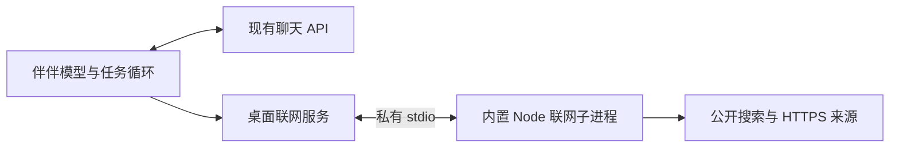

# 桌面自动联网设计

适用：macOS、Windows。实现及验收状态见 [验收记录](desktop_web_acceptance_2026-10-23.md)。2026-10-25 用户要求 Windows 验收后置，不再作为本轮完成条件；Windows 原生构建与运行仍未验证。

## 范围与费用

普通私聊、群聊、自动聊天、前台主动私聊及工作模式通过同一组联网工具搜索、读取、下载。模型按任务选择步骤，无联网开关，无新增搜索 Key。现有聊天 Key 只用于模型推理，额外轮次和正文按聊天服务商规则消耗 Token。

保留原有智谱专用搜索、新闻角色及圆桌流程。其 Key、开关、权限、用户轮次快照、缓存、来源和错误处理保持独立；失败不切换到免费工具。删除其他旧搜索提供商的运行代码、配置表单和专属测试，保留旧配置解码、备份兼容及凭据清理。

不借用 Codex、Claude Code 或 WorkBuddy 的账户或工具。无需安装、登录这些产品，也不要求服务商原生支持 web_search。聊天模型必须能遵循工具协议；仅配置兼容 API 格式不代表模型一定能正确执行。

## 进程与调用

伴伴管理一个按需启动、引用计数共享的子进程。退出或无租用时清理；进行中的请求失败不自动重放，后续新请求可重新启动。无本地 HTTP 监听端口，无额外常驻服务。Node.js 随安装包携带，不依赖系统 PATH、用户安装或运行时在线安装。

`gateway/src/desktop_worker.ts` 承载私有 stdio 协议和网络请求；`lib/features/web_search/desktop/` 承载进程租用、来源登记、搜索解析、正文读取、下载及普通聊天工具循环。聊天 Key 不进入子进程。

内置运行时按平台下载固定版本并核对 SHA-256；保留许可证。macOS 构建钩子及 Windows 打包脚本携带运行时和实际使用的 TypeScript 源文件。其他平台在创建进程之前返回未实现，Web 端不进入 dart:io 路径。

## 搜索、读取与下载

| 能力 | 行为 | 边界 |
|---|---|---|
| web.search | 解析 DuckDuckGo HTML；不可用时尝试 Bing HTML | 固定公开搜索地址；无收费搜索 API |
| web.read | 读取已登记来源，按段返回正文和分页位置 | HTML、文本、MD、PDF、DOCX、XLSX；不支持登录或 OCR |
| web.download | 下载原始字节并返回路径、大小、SHA-256 | 上限 64 MiB；唯一暂存目录；禁止静默覆盖或执行 |

来源只能来自用户明确提供的公开 URL 或真实工具结果，不能让模型任意编造来源编号。来源 ID 与快照有边界，持久化恢复先整体验证。自动联网引用使用 `[Wn]`，与原有智谱引用区分。

网络只访问公开 HTTPS 来源。请求检查主机、地址、重定向及大小，固定经验证的目标 IP，同时保留 TLS 主机校验，禁止私网、保留地址和通过重定向绕过检查。假 IP 环境的固定公开 DNS 回退仍须通过公开地址校验，不能关闭 TLS 或放宽私网访问。

搜索、读取、下载分别受超时和取消控制。下载分块传送并等待写入端背压；失败或取消清理未提交暂存文件。正文解析复用既有二进制文档解析器，保留压缩展开、条目、页数、行数和文本量限制。

公开 HTML 搜索不保证可达性或持续稳定。失败必须保留失败事实；直接读取已知 URL 不能伪装成执行过搜索。未知或需要认证的格式仅在符合网络及文件限制时下载，不进入自动执行流程。

## 聊天与工作模式

普通回复通过有界文本工具协议调用能力，不依赖服务商原生工具名称。协议内容不直接展示给用户。每次调用返回真实结果后再由模型答复，合并全部模型轮次用量；恢复、取消和上下文裁剪保留最新用户目标及必要来源。附件只在实际下载成功后出现。

新闻专用智谱角色继续走既有流程。自动聊天、前台主动私聊仍须满足各自原有资格、前台和预算条件；工具可用不等于可以自行发消息。

工作模式复用既有工具注册、阶段、精确路径策略、资源锁、审批和变更回执。调查和审查仅搜索、读取；下载属于文件变更，须进入获准阶段和目录。暂存文件移至合同路径仍走正常文件操作审批。目录不是普通文件；不支持的目录操作返回可恢复工具反馈，真实越界继续拒绝。

原文件下载使用一次实际制作，保留原始字节，不为制造进展而重复复制或改写。空下载暂存目录不属于交付文件，无需删除。

候选冻结后，每位验收成员必须实际收到本人的完整候选正文，才能生成本人的使用回执。分块读取进度按路径、内容摘要和块编号汇总，滚动上下文保留下一块位置。新的真实正文送达可算进展；重复请求、查询字符串变化和他人回执不能代替本人的读取。原有停滞、问题关闭、方案版本、独立测试和最终交付门槛不降低。

独立审查与本人试用的只读证据按阶段、成员、工作项、候选及版本归属。相同成员在同一绑定下重复取得同样结果仍会停滞；制作、调查和文件变更继续采用原去重规则。证据归属只影响进度判断，不代替完整读取回执或验收结论。

任务授权证据引用随需求版本变化；正式方案描述路径与读写权限，不冻结临时引用 ID。授权状态或范围真实改变仍须重新核对。旧任务、历史失败和产物不通过直接修改数据库来伪装恢复或通过。

## 验证与交付边界

验证分为静态检查、定向安全和行为测试、完整回归、运行时打包核对、真实模型适配器测试、真实页面任务验收。测试通过不等于 Windows 实机运行通过，也不等于所有服务商的所有模型都支持。

已保存的五个聊天配置使用正式适配器实测，普通私聊及工作私聊已完成搜索、读取、下载和原件核对。群内独立验收、本人完整读取回执及最终附件以最新验收记录为准。外部 GitHub 匿名额度耗尽等网络失败单独记录，不伪装成成功或关闭相关校验。
