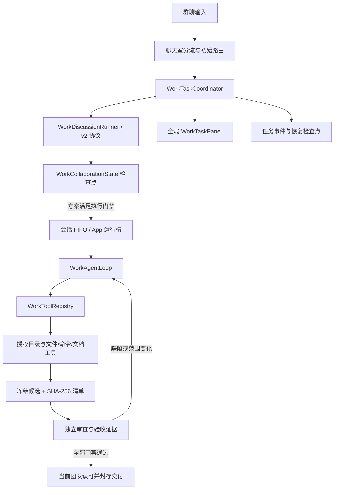

# 群聊工作模式技术指南（v2）

**适用范围：** 当前仓库的群聊工作模式实现\
**代码核对日期：** 2026-10-21\
**配套操作说明：** [工作模式使用手册](work_mode_user_guide.md)

本文按当前工作区源码描述实际行为。群聊工作模式的新任务使用 v2 协作状态；私聊工作模式和旧版未完成任务仍保留兼容路径。早期 v1 规格和分阶段实现记录属于历史资料，若与当前代码或本文冲突，应以当前实现为准。

## 1. 功能边界

群聊工作模式把一次用户请求变成有持久状态的任务：从当前群挑选相关成员，公开讨论并核对需求，形成方案和验收项，再制作实际文件、冻结候选、独立验证、按反馈返工，最后由当前团队对同一个候选版本完成认可后交付。

它与普通群聊使用不同的输入路径。工作模式开关按会话单独保存；开启后，该会话的非空输入进入工作任务路由，空闲自动聊天暂停。用户关闭开关不会取消已开始的任务；正在运行的任务由全局协调器继续管理。

群聊 v2 不以旧版“理解度达到 100%”作为执行门槛，也不按固定轮数凑讨论。当前执行门槛来自持久化协作状态、需求与团队版本、未决问题、验收证据、冻结候选和当前成员认可。私聊仍使用既有的固定角色工作流，不套用群聊的 v2 团队签字流程。

## 2. 技术栈与关键技术

| 层 | 当前采用 | 用途 |
|---|---|---|
| UI 与应用 | Flutter 3.27.1 / Dart 3.6.0 | 聊天室、任务面板、审批和恢复交互；Flutter SDK 版本由仓库 CI 固定。 |
| 状态注入 | `flutter_riverpod`，手写 `Provider` / `StateNotifierProvider` | App 级任务协调器、文件授权、工具和面板依赖；工作任务协调器不是自动销毁 Provider。 |
| 本地持久化 | Hive | `AgentTask`、工作区、消息和设置；群 v2 协作记录嵌入任务检查点。 |
| 模型调用 | `ChatApiService`、`AiRequestGateway`、Dio | 复用各角色已配置的模型与凭据，经过请求治理、费用/能力检查和协议适配。 |
| 模型协议 | OpenAI Chat Completions、OpenAI Responses、Anthropic Messages、Gemini Native | 按角色的 API 配置选择协议；群讨论结构化响应再经过 v2 JSON 协议校验。 |
| 流式响应 | SSE 解析器与 `ChatApiService` | 接收公开响应、结束帧、usage 与受限的生成活动信号；私有 reasoning 不作为角色公开发言或任务进展。 |
| 文件与进程 | Dart 文件系统、`file_picker`、受控命令执行器 | 目录选择、授权范围内的文件读取/写入、结构化命令和真实产物验证。 |
| 安全与完整性 | 路径策略、审批指纹、SHA-256、候选清单、快照、资源锁 | 限制路径和副作用，防止过期审批、并发覆盖或将旧文件误报为新成果。 |

工作模式只有一套 Agent 执行循环：`WorkAgentLoop`。旧的普通 `AgentRuntime` 已删除，不应再增加第二条执行循环。

## 3. 模块与职责

| 职责 | 主要实现 |
|---|---|
| 会话开关与输入分流 | `lib/features/chat_group/chat_room_page_session_support.dart`、`chat_room_agentic_input_support.dart`、`work_mode_config_service.dart` |
| 群成员初始路由与资格判断 | `work_role_router.dart`、`work_role_router_models.dart`、`work_role_model_selector.dart` |
| App 级排队、并发、恢复、审批动作 | `work_task_coordinator.dart` 及其 `work_task_coordinator_*.dart` part 文件 |
| 群讨论与公开协议 | `work_discussion_runner.dart`、`work_discussion_v2_session.dart`、`work_discussion_v2_protocol.dart` |
| 持久协作状态与门禁 | `work_discussion_state.dart`、`work_collaboration_state*.dart` |
| 工具循环、上下文、失败恢复 | `work_agent_loop.dart`、`default_work_task_runner*.dart`、`work_context_builder.dart` |
| 文件和路径 | `workspace_file_service.dart`、`workspace_mutation_service.dart`、`workspace_path_policy.dart`、`stage02_workspace_file_tool.dart` |
| 命令和副作用审批 | `work_command_runner.dart`、`work_command_policy.dart`、`work_mutation_policy.dart`、`work_task_approval_plan.dart` |
| 候选发布和独立审查 | `work_candidate_publication.dart`、`default_work_task_runner_review.dart`、`work_artifact_delivery_guard.dart` |
| 面板和全局宿主 | `work_task_providers.dart`、`work_task_overlay_host.dart`、`work_task_panel.dart`、`lib/main.dart` |
| 持久事件、快照与锁 | `work_task_event_store.dart`、`work_snapshot_service.dart`、`work_resource_lock_manager.dart` |

`WorkTaskOverlayHost` 挂在 `MaterialApp.builder` 下。聊天页负责保存用户消息并提交给协调器；页面销毁不会销毁正在运行的任务、任务面板或待处理审批。

## 4. 运行架构



App 总共最多同时占用两个工作运行槽；同一会话的任务按 FIFO 串行。群讨论和实际制作/验证共用运行槽。共享工作区还会按任务申请读写资源锁，避免不同会话同时修改相同目录时互相踩写。

## 5. 一次群任务的完整流程

### 5.1 开关、创建和首次检查

工作模式状态写在 `app_settings` 的 `work_mode_enabled:<conversationId>`。群聊控件打开开关后，输入会进入 `_runWorkModeTask`；新群任务最终经 `WorkTaskCoordinator.submit` 持久化，再由协调器排队。只有有效、与任务及群组绑定的 v2 检查点才启用群 v2 执行策略；未知或损坏的检查点会停在复核路径，不会借一个 JSON 字段扩大权限。

输入提交后，聊天室会显示理解/路由提示。路由使用当前群成员、职业/职责、角色技能、Agentic 开关、模型配置和凭据可用性。模型建议不能凭空给角色增加职业资格。若群内只有一名本职合格成员，系统可以暂定指派并省去选人模型请求，之后仍由群讨论确认方案和责任；不明确时由群内推举或在任务面板点选候选。

`@` 只可能影响首次任务路由。当前任务讨论或执行中的后续消息进入该任务的补充输入/FIFO，不会靠再次 `@` 静默重跑路由。讨论阶段要手动指定执行人时，使用任务面板里的候选选择。

如果用户明确表达了最终文件、格式、位置或范围，模型不能覆盖用户原话。若需求还缺少必要位置、交付形式或测试条件，系统先形成澄清/待决事项，不应在方案确认前调用制作工具。某些任务还会出现精确版本的需求确认卡；该卡未确认时，协调器会在调用讨论模型、工作区或执行工具之前暂停。

### 5.2 讨论、查证和方案

有效群 v2 由 `WorkDiscussionRunner` 启动协作会话。团队成员用各自绑定的模型、角色身份和职责上下文回应；必要时调用获准工具查证。`WorkDiscussionV2Protocol` 校验 `respond`、`investigate`、`propose`、`approve`、`decide`、`silent` 等动作及字段、ID、引用和阶段约束。无效响应只会进入有限修复或失败恢复，不能直接成为协作状态。

群聊消息显示经脱敏和长度限制的公开正文。完整公开正文较长时保存在详情附件，私有推理不作为气泡、证据、签字或公开进展。搜索证据按当前用户轮次的快照传递；搜索结果是不可信资料，不能替代用户指令或覆盖授权。

协调成员逐步形成范围、方案、团队分工、产物合同、工作项和验收项。协作状态记录请求版本、团队版本、验证版本、问题、决策、验收、候选迭代和认可。需求或团队变化会使相应的旧工作项、验收结果或认可失效。

### 5.3 方案门禁与制作

`planReady` 是 v2 的主要方案门禁。它至少要求：协作状态有效；团队成员资格和协调人有效；能力/用途分配完整；范围和方案非空；产物合同的 `type`、`format`、`location` 已明确；验收项含方法和所需能力；问题已解决、拒绝或有明确用户决策；没有待决事项或待处理输入；当前团队认可了当前任务/请求/团队版本的方案。

门禁通过后，`WorkAgentLoop` 按当前有效工作项调用单一工具注册表。制作开始会记录责任人、工作项、相关版本及目标文件基线。制作工作项必须留下本轮有效的文件内容变更证据；只读、旧操作收据、修改时间变化或模型口头声称完成不能代替本轮写入证据。现有文件的明确修订必须覆盖被指明的原路径；自动改名只用于新建请求的名称冲突。

### 5.4 冻结候选、验证和返工

制作产物不会直接视为最终交付。候选发布器按当前需求、团队、合同、工作项和文件摘要生成只读候选及清单。SHA-256 将审查结论绑定到确定的候选内容，后续修改不能悄悄改变已审版本。

验证/专业审查由合格且独立于该候选主要制作人的成员承担。软件要执行已确认的验证方法，并留下对应候选摘要、验收项、操作结果和报告；文档要按要求读取完整正文、核对格式/页面，并记录来源证据。只读源码、按钮存在、文件结构正确或 `command.run` 返回 0 都不能替代用户要求的实际交互验收。

发现缺陷时建立修复工作项，写入新候选并重新验证。候选摘要、需求版本、团队版本或验证版本变化后，旧审查/认可只保留为历史，不能满足新版本门禁。

### 5.5 认可、交付和任务状态

`deliveryReady` 要求当前方案有效、相关工作项完成、所有团队成员已参与、当前候选已冻结并完成审查、验收都有实际证据且处于 `passed`、`manual` 或有明确用户记录的 `waived` 状态，没有未处理问题/决策/输入，并且当前团队对相同候选摘要和验证版本完成交付认可。

`WorkTaskCoordinator` 在最终提交前再次核对协作状态、候选和新到输入。只有正式交付边界通过后才把任务记为 `completed`，并封存交付记录。用户豁免必须保留被豁免的原验收项、原因和风险，不能改写成自动通过；人工验收记为 `manual`，不能伪造自动测试日志。

任务状态包括 `queued`、`planning`、`runningTool`、`waitingForApproval`、`paused`、`interrupted`、`completed`、`failed`、`partiallyCompleted` 和 `cancelled`。等待审批、暂停、中断、失败、部分完成或用户停止都不等于任务完成。用户停止的群 v2 任务可以在原检查点继续；v2 任务不能用会清空协作历史的“从头开始”冒充恢复。

交付文件已通过合同和完整性校验，但聊天附件发送失败时，任务仍可保持 `completed`，面板会保留单独的重发提示。此时只重试附件发送，不重新生成或覆盖已验证文件。

## 6. 工具能力与限制

工具名来自 `AgentToolName`。模型响应先经解析器、schema、角色能力、路径/命令策略和任务状态检查，再交给 handler；不能把模型生成的工具名或参数当成授权。

| 工具 | 能力 | 主要边界 |
|---|---|---|
| `workspace.list` / `workspace.read` / `workspace.search` | 列目录、分段读取、在授权工作区检索 | 路径必须通过授权目录和敏感文件策略；敏感读取可能要求单独确认。 |
| `workspace.document` | 读取文档正文、按页/块读取或渲染 | 分块读必须走到任务要求的范围；检索片段不等于全文，正文提取不等于视觉版式检查。 |
| `workspace.patch` | 写入、追加、基于摘要的精确替换、合并分段 | 写入通过变更计划、路径策略和审批；明确修订需要沿用目标原路径；二进制 DOCX 不能用伪造文本冒充。 |
| `workspace.rename` / `workspace.delete` | 重命名或删除授权目录内文件 | 属于副作用操作，按风险和当前审批计划处理；删除及不可恢复操作不能被模型自行视为已获批准。 |
| `command.run` | 以结构化 `executable` 与 `arguments` 运行验证或转换工具 | 不接受模型提供的任意 shell 字符串；命令策略检查可执行文件、参数、工作目录、声明影响和风险，失败可被阻断、限时或要求用户审批。runner 默认单次 60 秒、输出上限 512 KiB。 |
| `weather.forecast` | 获取真实天气预报 | 经服务端点与参数校验；失败状态与不可重试数据错误分开记录。 |
| `skill.create` / `skill.download` | 创建或安装应用内 Skill | 需要匹配的任务能力和授权，写入进入技能变更审批流程。 |
| `skill.github.search` / `skill.github.import` / `skill.resource.read` | 发现、固定版本并导入公开 Skill 资源 | 搜索和导入走受控 Gateway；不把任意地址交给模型直接抓取。 |
| `browser.context` | 在隔离离线 WKWebView 中打开当前冻结的软件候选并按已确认步骤操作/断言 | 只在 macOS、有效 v2 群软件任务、角色能力与既有权限都满足时注册；不能任意打开 URL/路径或运行脚本。 |
| `native.app` | 操作已授权的 macOS 测试 App | 仅在相应平台能力和任务合同允许时提供；操作和证据必须绑定当前候选与运行会话。 |

工具集会按角色能力、任务类型、阶段和权限裁剪。表中列出了代码支持的能力，不代表每项工具都对每个任务、角色或平台开放。

## 7. 权限、安全与可靠性

### 目录与凭据

目录授权和 Agent 设置保存在 `app_settings` 的 `work_mode_folder_grants_v1`、`work_mode_agent_settings_v1`。首次授权通过系统目录选择器，并明确披露目录内容可能发送给当前角色所用 API。授权只给 App 使用，不改变目录本身；目录移动或系统权限变化后需重新核验/授权。

聊天 API 凭据由 `SecureStorageService` 收口，按平台实现存储。API Key 不应写入任务日志、工作模式设置、事件正文、候选报告或测试夹具。连接测试要直接使用表单本次输入的 Key，不能临时写入安全存储再读回；测试完成也不走删除临时凭据的回路。

### 文件、审批与外部内容

所有工作路径都要经 `workspace_path_policy.dart` 规范化并验证授权范围；工具 handler 在执行前重新验证身份、权限和任务版本。文件修改由 `WorkspaceMutationService` 形成内容变更计划，审批指纹绑定具体操作，候选/快照记录修改前后摘要。过期面板或聊天按钮会按任务、阻塞项和版本拒绝，不能批准另一条操作。

命令不是不受限的终端代理。`WorkCommandPolicy` 会拒绝危险或工作区外操作；`WorkCommandRunner` 对进程时限、输出大小、取消、凭据提示和缺失工具进行边界控制。安装工具、目录外写入、敏感读取和高影响操作按当前策略等待明确批准。

用户消息、附件、文件内容、Skill、搜索结果和工具输出都视为不可信资料。它们不能自行改变交付合同、角色资格、目录授权、审批结果或命令范围。向界面发布的模型/系统文本需脱敏并做人类可读 ID 映射；原始 ID 和权威状态继续落在检查点/事件中。

### 排队、恢复和防止无界运行

协调器先把任务和输入持久化，再调度 runner；同一会话输入进入 FIFO，不取消正在执行的任务来静默吞掉新输入。任务状态、完成操作、v2 协作状态、附件引用和候选索引保存在本地；事件和文件版本证据留在对应本地工作区。离开页面不停止任务。

启动恢复会重核项目绑定、当前成员资格和配置、目录权限、文件摘要、工具收据，并重新申请资源锁。设备本地的审批和工具收据不作为跨设备可执行授权；无法证明副作用已提交时，不盲目重放命令或追加写。系统不承诺所有外部副作用普遍 exactly-once。

有效群 v2 不受旧版累计动作数/整轮时长上限限制，但仍受单次模型/命令时限、协议重试和进展守卫约束。默认单次模型总时限为 300 秒；请求发出 180 秒内若仍未收到正文字符或解析器识别的响应活动，会触发首响应停滞处理；收到响应活动只会撤销首响应停滞计时，总时限仍保留 300 秒。生成活动只能说明模型还在响应，不能作为工作进展或验收证据。v2 进展守卫在相同条件的失败连续 3 次或连续 8 个结果没有带来新问题、证据、验收或文件内容变化时停止自动推进并转为可恢复阻塞。只有归类为可重试网络失败的路径进入有限自动续跑；等待用户/审批、主动暂停、停止、完成和删除都不自动续跑。

上下文预留依据模型能力表中的最大输出与上下文窗口的一半取较小值；客户端不对 OpenAI Chat Completions、OpenAI Responses、Gemini 自设绝对输出上限，Anthropic Messages 按协议要求发送 `max_tokens`。服务商仍有自己的上下文、输出与费用限制。长内容应先分段写入中间文件（单次 `workspace.patch` 正文不超过 3000 字），再用 `parts` 合并成正式 Markdown 源并读回核对；用户要求 DOCX 时要由 `pandoc` 等已验证转换工具生成真实 DOCX，Markdown 不能冒充最终 Word 文件。

## 8. 如何进入测试

### 8.1 代码自动化测试

从仓库根目录执行。模型协议和文件测试用假模型/临时目录，不需要连接真实 API。

```bash
flutter pub get
flutter analyze

# 路由与资格
flutter test test/work_mode/work_role_router_test.dart

# v2 协作协议、状态门禁与讨论
flutter test test/work_mode/work_discussion_v2_test.dart
flutter test test/work_mode/work_discussion_v2_regressions.dart
flutter test test/work_mode/work_discussion_runner_test.dart
flutter test test/work_mode/work_collaboration_state_test.dart

# Agent 循环、故障恢复、命令与文件安全
flutter test test/work_mode/work_agent_loop_test.dart
flutter test test/work_mode/work_failure_recovery_test.dart
flutter test test/work_mode/work_command_runner_test.dart
flutter test test/work_mode/workspace_file_service_test.dart
flutter test test/work_mode/work_artifact_delivery_guard_test.dart

# 协调器、聊天输入与集成路径
flutter test test/work_mode/work_mode_end_to_end_test.dart
flutter test test/work_mode/work_mode_s8_end_to_end_test.dart
flutter test test/work_mode/work_mode_chat_ui_integration_test.dart

# 该变更相关回归通过后，执行全仓测试
flutter test
```

CI 的 Flutter 顺序为 `flutter pub get` → `build_runner` → `flutter analyze` → `flutter test`。修改 Hive/JSON 序列化模型后必须先执行 `dart run build_runner build --delete-conflicting-outputs`。单个测试在 CI 超过 30 秒按疑似死循环失败；Widget 测试遵守 `CLAUDE.md` 的 pump 和 `AppToast` timer 约束。

选择测试应匹配改动层：改 router 跑角色资格测试；改 v2 状态或协议跑讨论/状态回归；改工具/授权跑路径、命令和审批测试；改面板跑 panel/UI 集成；改跨模块分派跑端到端测试。全仓测试通过也不能替代逐行审查或真实 App 验收。

### 8.2 在真实 App 中手工验收

真实 UI 验收用于检查界面输入、真实模型、操作审批、磁盘文件和平台能力串起来后的行为。准备专用测试群、合成聊天内容、测试模型配置和临时测试目录；不要在真实会话或用户项目里试写文件，不要把凭据放进命令行、测试日志或文档。

1. 在「设置 → API 配置」配置可用模型，并将其绑定到具备对应职业/技能且开启 Agentic 的群成员。至少准备能覆盖当前请求的执行和独立验证能力。
2. 在「设置 → 工作模式 AI Agent → 授权目录」仅授权临时测试目录，并完成目录/云端 API 披露确认。
3. 创建或选用专用测试群，将需要的合成角色加入群组。不要通过改写仓库 `data/` fixture 来制造手工验收数据。
4. 在目标群聊打开顶部会话控件中的「工作模式」。确认界面提示工作模式已开启、空闲自动发言已暂停。
5. 发送小型、可验证、可撤销的请求，明确目标文件路径、交付格式、需求范围和验收条件。首次验收不要用破坏性命令、目录外路径或真实个人资料。
6. 打开全局「工作任务」面板，记录任务 ID 和状态。检查路由/需求提示、公开成员讨论、当前方案、工作项、待决项和用户操作入口是否与聊天消息一致。
7. 到写入/命令步骤时检查审批弹窗中的准确路径、命令参数、风险和变更计划；只批准本次测试明确需要的具体操作。拒绝和稍后处理也应能安全恢复。
8. 核对冻结候选文件、摘要、独立审查报告、验收状态和团队认可都对应同一需求/团队/候选版本。最后在文件系统确认目标路径、真实内容、可打开性和最终摘要。
9. 对软件任务实际运行产品并覆盖验收步骤；对文档任务完整读取正文并按要求核对渲染页面。出现失败时要求修复并复测新候选，不要用“已完成”气泡或测试命令退出码替代结果。

在 macOS 可用 `flutter devices` 确认设备后运行 `flutter run -d macos`。需要 `browser.context` 的软件验收必须在满足权限/能力条件的 macOS v2 群任务中执行；若平台或权限不具备该能力，应将该验收标记为阻塞，不能退回读源码或人工声称通过。

记录证据时保存测试群/任务 ID、阶段状态、候选摘要、验收方法与结果、实际目标路径。事件日志和聊天内容可能含用户数据，分享前需脱敏；不要记录 API Key 或完整敏感文件正文。

## 9. 完成判据

“完成”有三个不同含义，应在报告中说清是哪一个。

| 层级 | 通过条件 | 不通过的典型情况 |
|---|---|---|
| 代码改动完成 | 需求对应实现已检查；受影响的 router、状态转换、工具调用和恢复分支均覆盖；相关测试、静态分析和所需的全仓回归完成；没有把未检查路径报成已通过。 | 只跑过一个测试、只修一个触发入口，或存在未处理的同根因路径。 |
| 一次群工作任务完成 | `AgentTaskStatus.completed`；正式交付门禁通过；最新候选已冻结并匹配当前合同；每项验收有真实证据或有明确记录的 `manual`/`waived` 决策；当前团队认可同一候选和验证版本；无未处理待决输入/阻塞；产物在合同位置可读取。 | 仅有模型口述、文件未变化、候选旧摘要、测试者与制作人不独立、验收仍 `pending`/`failed`，或任务停在审批/暂停/失败。 |
| 真实 UI/E2E 验收通过 | 从真实群聊开关和输入开始，确认进入 v2 任务；按实际界面完成所需授权/审批；最终文件、内容、位置、可打开性和行为均匹配原始请求；返工问题复测通过；现场证据能回指当前候选。 | 自动化测试绿但用户请求产物未生成、真实交互未执行、失败没有复测、或面板与实际文件不一致。 |

运行状态 `completed` 是任务流程的完成信号，不单独证明某个具体产品在真实环境中的所有质量目标都达到；一项具体验收只能由它绑定的证据证明。`manual` 和 `waived` 不是自动测试通过；豁免要由用户明确选择并保留风险。附件发送失败可作为“文件任务已完成、消息交付待重发”单独报告。

## 10. 相关资料与维护入口

- [工作模式使用手册](work_mode_user_guide.md)：UI 操作、按钮、权限和常见恢复方式。
- [群工作 v2 需求矩阵](group_work_discussion/02-requirements.md)：需求与历史验收条目；部分早期词条是设计阶段记录，不覆盖后续实现约束。
- [v1 技术设计](work_mode_agent_v1_technical_design.md) 和 [v1 需求](work_mode_agent_v1_requirements.md)：旧架构/规格的历史基线，不能把 v1 的“理解度 100%”当成当前群 v2 门槛。
- `docs/verification/`：按任务记录真实运行证据和阻塞；现场结论会变化，不能由自动化测试结果替代，也不应把一条任务记录泛化成所有任务的统一结果。
- 测试目录：`test/work_mode/`。自动化端到端入口包括 `work_mode_end_to_end_test.dart`、`work_mode_s8_end_to_end_test.dart`、`work_mode_chat_ui_integration_test.dart`；真实 UI 验收使用专用测试群和临时目录。

实现或测试流程变化时，先更新本文对应的模块、命令或验收条件，再核对 [docs/PROJECT_MAP.md](PROJECT_MAP.md) 索引；不要在多个文档里复制一份容易漂移的约束。
