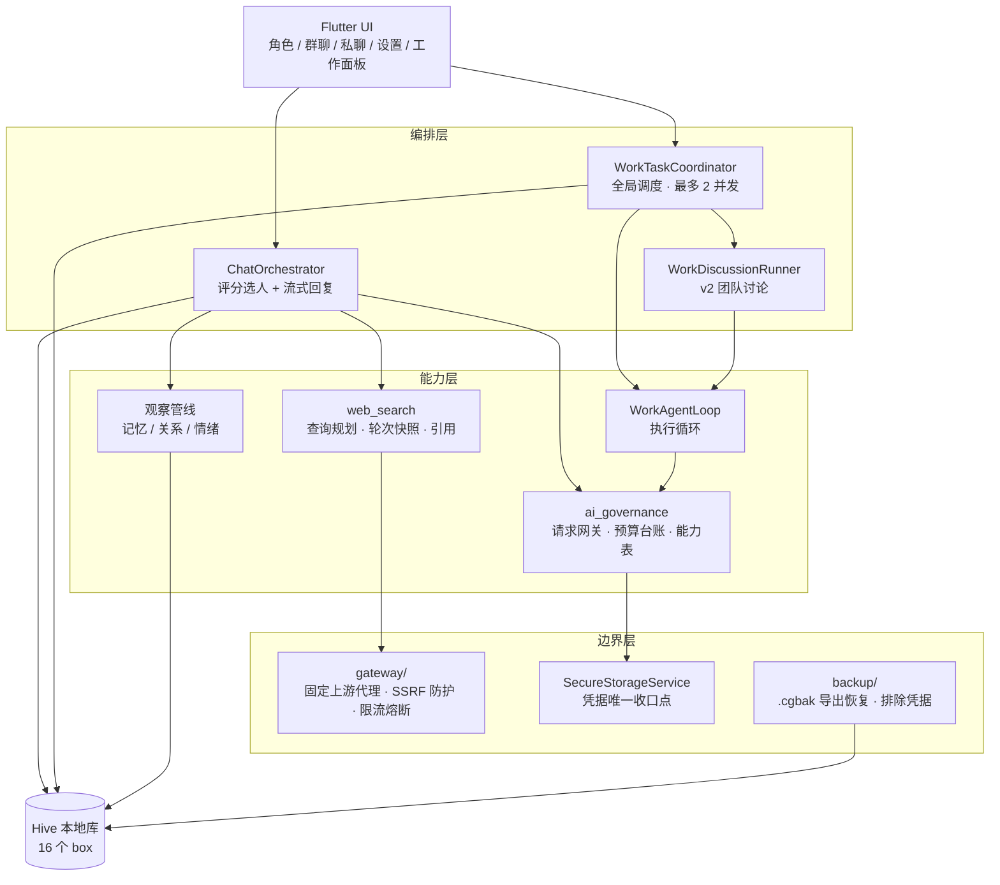

# 伴伴 · 作品卡

> 一句话：**一个本地优先的 AI 群聊模拟器 + 具备真实执行能力的多角色工作代理。**
> 它让多个 AI 角色在一个群里互相认识、记住彼此、按关系与情绪自然接话；打开工作模式后，同一批角色会组队讨论方案、分工执行真实文件任务，并互相审查与验收交付物。

**作品简介（92 字）**

> 本地优先 AI 群聊应用：角色有头像音色，支持群聊、私聊、圆桌模式与多人实时同群；AI 依关系情绪自然接话，能语音输入播报、联网搜索带引用；开工作模式后角色组队讨论、真实读写文件并交付产物。

**上手就能玩到的能力**

| 能力 | 用户实际看到的样子 | 深入见 |
|---|---|---|
| **头像** | 每个角色有头像；发言按角色分组呈现，客人端也能认出"这句是哪个角色说的" | 一 |
| **语音** | 输入区有麦克风开关：点一下开始聆听，语音实时转写成待发送文本，再点一下结束聆听、文本落定可编辑（火山 ASR）；也可以让角色把回复读出来（TTS）。开始聆听前会先停掉正在播报的回复，避免麦克风把 AI 自己的声音收进去 | 一 |
| **群聊** | 拉任意多个角色成组。按 @ 提及、最近发言、关系状态与话题契合度决定"谁该说话"；没人说话时群会自己聊，但节奏被严格控制住，不会刷屏 | 一、四·环节 1 |
| **私聊** | 与单个角色一对一，有独立收件箱；角色也能主动找你（**仅 App 运行期间**，冷却保守，不做假推送） | 一、四·环节 4 |
| **圆桌模式** | 每轮**全员依次发言**，并内置一位"不发言的检索助手"为所有人备料；按群持久化 | 一 |
| **多人实时同群** | 用邀请码入群，**多个真人**可以和同一群 AI 角色实时同处一室；客人端只读，不碰主人的本机数据 | 一、附录 A |
| **联网** | 角色可"先搜后答"，回答带来源编号与引用；搜索结果一律当作不可信外部数据 | 三·亮点五 |
| **工作模式** | 在群里打开开关，同一批角色组队讨论方案、推举执行人、真实读写文件与跑命令，产出交付物并互相审查验收 | 一、三、四·环节 5 |

> 这八项共用同一套角色、记忆与关系模型——**不是八个独立功能，是同一条链路的八个切面**。正因如此，工作模式不是"另一个 App"：它让给角色写的人设直接决定它被推举去干什么活。

| | |
|---|---|
| 形态 | Flutter 桌面/移动应用（macOS / Windows / iOS / Android） |
| 版本 | `2.3.5+14`（Flutter 3.27.1 / Dart 3.6.0） |
| 代码规模 | 582 个 Dart 文件、约 16.4 万行（`lib/`）；网关 2,814 行 TypeScript |
| 测试规模 | 300 个测试文件、3,329 个 Flutter 用例 + 51 个网关用例 |
| 开发周期 | 2026-07-06 起，393 次提交，5 位贡献者 |

---

## 一、作品是什么

伴伴是一个**本地优先（local-first）的 AI 角色群聊与协作应用**。它不做"你问我答"的单轮对话，而是模拟一个**真实的多人聊天群**：

- 用户创建任意数量的 AI 角色（人设、系统提示词、头像、回复频率上限、性别），自由组队成群；
- 用户发言后，应用不是让所有角色都回复，而是**按角色评分选出该说话的那几个**——综合 @ 提及、最近发言顺序、关系状态、话题契合度与长期记忆；
- 无人发言时群会**自动闲聊**：进群 8 秒后启动，连续发言最多 4 轮后强制静默 35 秒，间隔按群设置（5–60 秒）并叠加随机抖动，避免"机器人在刷屏"的观感；
- 每个角色对每个对象有**有向关系状态与情绪**，情绪有 30 分钟有效期，会真实影响它下一句话的语气；
- 记忆分四层沉淀：群周记忆（`2026_W37` 这样的 ISO 周键）、角色分层记忆、关系事件流、永久记忆；
- 角色带**头像与音色**。输入区可以点开麦克风直接说话（语音实时转写成待发送文本，再点一下结束聆听、落定可编辑），也可以让角色把回复念出来；开始聆听前会先停掉正在播报的回复，避免麦克风把 AI 自己的声音收进去；
- **圆桌模式**是群聊的另一种推进方式：不走评分选人，而是每轮**全员依次发言**，并自动为群里加一位"只检索、不发言"的助手角色，给所有发言者备料。对话因此更像一场会议记录，而不是一群人抢话；该模式按群持久化；
- **多真人实时同群**：用邀请码入群，**多个真人**可以和同一群 AI 角色实时同处一室。客人端刻意只读——既不写主人的本机数据库，也不会被当成立场角色参与选人。

在此之上，是它的第二个形态：**工作模式**。在同一群聊房间里打开开关，用户的话不再走闲聊，而是被路由成一条**工作任务**——由群成员组队讨论、推举执行人、调用真实工具（读写文件、跑命令、解析文档、查天气）、产出交付物、独立审查、返工复测，最后由各成员逐人认可交付。

> 它同时是"陪聊产品"和"能落地的多代理执行框架"，且两者共用同一套角色、记忆与关系模型。

---

## 二、解决什么问题

### 1. 多个 AI 角色凑在一起，会退化成"各自念台词"

直接给多个模型拼一个群聊，会立刻遇到四个问题：**都说、抢话、健忘、无差别**。模型之间没有"关系"，每轮都像第一次见到对方。

伴伴的解法是把"谁来说、说什么"变成两个可解释的打分与状态系统：

- **说的问题** → 回复资格策略（提及优先、最近发言降权、频率上限、群内静音）+ 空闲自动聊天的节奏控制（突发上限 + 强制静默 + 抖动）；
- **忘的问题** → 分层记忆：单条消息不直接进提示词，而是经"观察管线"提炼为角色记忆与群周摘要，并有容量与频率约束（≥8 条消息且 10 分钟内最多一次，且只对群聊生效）；
- **无差别的问题** → 有向关系状态 + 情绪有效期。普通事件不改变情绪，避免"忘了过期"的情绪污染提示词与评分。

### 2. AI 只会"说"，不会"做"

市面上大量"AI 助手"止步于生成一段文字。让它真正改文件、跑命令，就必须回答三个工程问题：**它有没有权限、它的动作能不能被审计、它卡住了能不能接着跑。**

伴伴的工作模式给出的答案是：

- **权限**：目录授权与代理设置落盘后带指纹，任何变更都要走显式审批对话框；命令执行器默认阻塞（`blockedByDefault` / `pathRejected` / `waitingForApproval` 三态），不是"先跑起来再说"；
- **审计**：模型看到的是公开检查点，**永远拿不到自己的私有推理轨迹**；任务的全部事件、候选版本、审查报告、签字都落在设备本地，可逐条回溯；
- **可续**：任务停在等用户、等审批、主动暂停、网络失败、应用被杀——每种中段状态都有明确的恢复路径，且**不会静默丢弃用户新输入**（新输入排队，旧任务结束后派发，禁止"取消旧任务顺手丢掉新请求"）。

### 3. 多模型接入是碎片化的

8 家厂商、4 种上游协议（Anthropic Messages / OpenAI Chat Completions / OpenAI Responses / Gemini `generateContent`），各自的流式格式、错误语义、token 计量方式都不同。伴伴把差异收在一个协议层里，并在其上叠了**用量治理**：请求网关 + 预算与计价台账 + 模型能力注册表，所有凭据走统一收口点，导出与备份路径被工程化地排除密钥字段。

---

## 三、亮点

### 亮点一 · 一个群，两个形态：闲聊与干活共用同一套角色模型

工作模式不是另一个 App。打开开关后，**同一批角色、同一套人设与技能**从"聊天的人"变成"干活的人"。这带来一个别处很少见的效果：给角色写的人设直接决定它被推举去干什么活。

角色路由（`WorkRoleRouter`）从角色推断的**阶段与职业**加上 `CharacterSkill` 里选举执行人，且有一条硬规则：**模型的推荐不能凭空发明一个资格**。当群里只有一位成员本职合格时，系统直接指定他，跳过选人模型调用；但若用户只是 `@` 某人**征求意见**，则不做自动指定——"判错方向必须是保守的"。

### 亮点二 · 讨论是有约束的，不是让模型自由发挥

工作模式 v2 的协作流程把"讨论"变成了有状态机、有门禁的形式：

```
选团队 → 逐项查证未决问题（证据绑定消息 id）→ 形成方案 → 逐成员认可
      → 制作 → 冻结候选 → 独立审查 → 返工复测 → 逐成员认可交付
```

其中几处设计值得单说：

- **证据要绑定**：问题必须挂上真实消息 id 作为依据，一轮发言逐项落盘。因此"第二项被拒"不等于"整轮没被采纳"——被引用的正文原样保留，拒绝只记诊断事件。否则已提交问题的依据会被替换成一句中性说明，**问题依据就此失真**。
- **签字容量按"当前主体"算**：签字台账是只追加的，历史上限 64 条。若按列表长度判容量，30 轮旧候选就能让第 65 条**当前**签字把整个状态解析成 `null`、任务永久卡住。所以读取判据只钉在当前主体上，旧迭代签字对任何门禁都不可见，但历史凭证仍留在群里的公开回复里。
- **产物合同只有一个词表**：`software` / `source` 两类拼写曾被当成两种东西，后果是整段软件闭环检查失效——真实入口把"制作飞行棋 HTML 游戏"判成 `source`，而材料工作项、测试覆盖、独立审查资格都在比 `software`，于是**读一遍正文就能宣称那个游戏通过审查**。归一化因此挂在状态构造函数上（落盘与内存两条路都要过），而不是提交点。
- **公开增量不能代签**：除讨论流程外的任何路径，都只能原样携带已有签字；新增或改写一条交付签字必须来自真实的成员请求-响应，判据是签字内容的指纹而不是事件 id。

### 亮点三 · 产物必须有合同，且"结构正确 ≠ 已运行"

`WorkArtifactDeliveryGuard` 为交付物定义合同（DOCX/HTML 等结构校验），候选发布与独立审查还会核对**真实文件摘要**。文档审查强制完整读取正文（`workspace.document` 用 `startChunk` / `nextChunkStart` 有界分页），**检索片段不能冒充全文**。

同时团队刻意保留了一条诚实的边界并写进文档：**结构正确不等于软件已运行测试**；浏览器能力（`browser.context`）在枚举与提示词里存在但没有运行时注册，因此**缺浏览器能力必须阻塞或走用户明确的人工验收/豁免**，不允许静默跳过。

### 亮点四 · 长内容必须分块写，且截断判定跨协议

一次模型请求的输出上限由模型能力表决定（声明上限与上下文窗口一半取小），客户端**不设任何绝对天花板**——没有依据替用户判断厂商真实能力。但长交付物会撞上这个上限，于是契约写进提示词：先建分段文件，此后每次 `{"append":true}` 追加 ≤3000 字，最后合并成交付物。

关键在于**截断判定跨协议**：OpenAI 兼容解析器有 `finish_reason == 'length'`，而 Anthropic / Responses / Gemini 没有。命中截断后，修复指令与之后那次协议重试都必须把策略换成"分块写"——只要求"输出合法 JSON"没有用，**被截断的正是"一次写完整份文件"这个动作**，原样重试会再撞一次上限。

### 亮点五 · 生产级搜索网关：客户端永远不能自选目标

`gateway/` 是一个**固定上游代理**，不是通用 URL 抓取器：客户端只能 `POST /v1/search` 提交查询，**永远无法决定请求打到哪里**。网关侧拒绝私网 IP 并钉定已验证 IP（防 DNS rebinding）、生产环境强制 Bearer 鉴权、按 token 限流 + 日配额 + 熔断、并且**不记录查询内容与凭据**。

客户端侧，搜索结果一律视为**不可信外部数据**：结构化证据 + 来源编号 + 提示词注入防御 + 密钥扫描器。搜索凭据走独立的安全存储命名空间，绝不复用业务配置字段。搜索按**用户轮次**作用域：一轮里多个 AI 回复共享同一份搜索快照。

### 亮点六 · 本地优先，且对"加密换确定性"这个取舍是明确的

所有数据存本地 Hive，无需服务端即可完整使用。凭据走 `SecureStorageService` 单一收口点，**新加凭据类型不需要各自实现回退**。

值得一提的是一处被刻意写进文档的取舍：**macOS 上凭据（含 API Key）以明文存在本地 Hive 库中，不走钥匙串**。原因是本项目 macOS 构建始终是 ad-hoc 签名，钥匙串 ACL 认不出每次重建后的二进制——debug 下每次读取都弹一次登录密码框，release 下启用 Data Protection Keychain 则直接写入失败。**确定性比加密层级更实用**，但这个代价（能读到用户数据目录的进程就能读到 Key）被明确记录，而不是藏在注释里。其余平台维持系统安全存储。

### 亮点七 · 可测试性被当作架构约束

为了"能被测试"，团队做了一连串不显眼但关键的结构决策，并把踩过的坑写进文档：

- 聊天室为覆盖多选、批量删除等模态行为维护 `canDeleteRoomMessage` / `selectableMessageIds` **一份共享判据**，避免"新规则只落在一侧，多选就能绕过它"；
- 大测试套件拆成 `*_part_NN.dart` / `*_helpers_NN.dart`，新增用例必须进正确的分片文件而非新建顶层套件；
- 死循环防护是**硬规则**：`initState` 禁止 `addPostFrameCallback` → `setState` 链条、单用例超 30 秒视为疑似死循环、`AppToast` 的 3 秒 Timer 在测试中必须用 `tester.runAsync()` 隔离。

---

## 四、AI 承担了什么（逐环节）

这是本作品最需要说清的部分：**AI 不是被调用的一个接口，而是承担了从"谁说话"到"活干完"的整条链路。**

### 环节 1 · 决策"谁来说话"（评分选人）

`ChatOrchestrator` / `HumanizedChatOrchestrator` 对每个可参与角色打分：@ 提及、最近发言衰减、关系状态与情绪、话题契合度、长期记忆相关性、回复频率上限、群内静音。用户一轮最多 3 条回复（消息里 @ 了人时降为 2 条）。

### 环节 2 · 生成回复（流式）

`ChatApiService.streamChatMessage` 走 SSE 流式，`SseParser` 抽取 `usage` 用于 token 记账。流式通道返回空内容时可对同一请求回退一次非流式调用；标准 `content` 为空时才允许读兼容字段 `reasoning_content`；两者皆空必须报错。

### 环节 3 · 提炼记忆（AI 读 AI 说过的话）

观察管线把消息提炼为角色记忆、关系事件与群周摘要。触发条件有明确工程约束：≥8 条消息、10 分钟内最多一次、**只对群聊生效**（私聊不做摘要）。

### 环节 4 · 主动私聊（AI 主动找用户）

允许在 App 运行期间调用已配置的 LLM 主动发起私聊，但**冷却时间保守**；在没有明确的通知/推送设计前，禁止后台或离线网络生成。这是一个刻意的产品边界：能力先做到"App 开着时能主动"，而不是假装做到了推送。

### 环节 5 · 工作模式：AI 组队、AI 讨论、AI 执行、AI 审查

| 子环节 | AI 做什么 | 关键约束 |
|---|---|---|
| 角色路由 | 从阶段/职业 + 技能库推举执行人 | 模型推荐**不能发明资格**；用户只是征求意见时不做自动指定 |
| 讨论 | 选相关团队 → 查证未决问题 → 形成方案 → 逐成员认可 | 证据绑定消息 id；一轮发言逐项落盘 |
| 执行 | `WorkAgentLoop` 驱动，调真实工具完成工作项 | 看到的只有公开检查点，无私有推理轨迹 |
| 候选冻结 | 产出候选交付物并冻结 | 按真实文件摘要核对 |
| 独立审查 | 由**不代表执行人**的成员审查 | 审查资格与材料工作项、测试覆盖挂钩 |
| 返工复测 | 审查不通过则返工后复测 | 迭代索引保留最新 64 条，权威记录在磁盘 |
| 交付验收 | 各成员逐人认可交付物 | 签字必须来自真实请求-响应 |

模型能调用的工具：沙箱化命令执行器（默认阻塞 + 审批）、工作区文件服务（列/读/搜/改/改名/删）、文档工具、天气服务、技能创建与下载。

### 环节 6 · 失败归因（AI 干砸了要能说清为什么）

这一环最容易被忽略，却是"可用"与"演示"的分水岭。团队把三类高发失败做了**可判定的归因**：

- **首字节停滞 vs 总时限**：工作模式一次模型请求有两个时限——总时限（默认 300s）与**首字节停滞**时限（默认 180s，只在"一个字符都还没收到"时计时）。两者在用户可见文案里都被折叠成"任务执行超时"，所以归因不走文案，而由 `WorkModelDeadlineException` 带着码一路写进事件元数据，且失败类型映射必须同时认这两个码。**零输出意味着不存在任何已生成内容，提前放弃并重试不会丢掉工作**；而总时限做不到这么激进，它必须容下"生成很慢但正在输出"的请求。
- **协议重试有三种成因**，面板标题必须分开：输出用满预算（→ 改策略分块写）、修复请求自己失败（→ 链路问题，该重试）、模型写坏 JSON（→ 收窄要求或换模型）。诊断另记 300 字有界正文开头用于定性。
- **失败记录与成功记录分开放**：用量台账只记成功调用，失败落在设置箱的诊断条目里。查"为什么失败"只看后者。

> 2026-09-30 现场是一个典型佐证：某轻量模型对 16.8k 输入的三个请求各吞掉 300 秒零输出，占整轮 23 分钟里的 15 分钟。正是这次现场催生了首字节停滞时限与它的独立归因码。
>
> 同一条思路的更早一次闭环见 **5.2 节**：本机数据集里 2026-07-31 的失败记录显示 131 次失败**全部**是 `timeout`，且耗时钉死在 30.08 秒——后被 git 历史证实是客户端 30 秒 `receiveTimeout` 误杀正常请求，而非模型问题。两次事件的共同教训是：**没有归因码时，"超时"这一个词会同时盖住"模型没能力"和"客户端阈值设错了"两件完全不同的事。**

---

## 五、效果与数据

### 5.1 真实运行数据（本机开发数据集）

下表全部由本机 `data/*.hive` 数据库**直接解析得出**，采集方法见附录 C。

**AI 调用（`ai_governance_ledger`，覆盖 2026-07-16 ~ 07-31，9 个活跃日）**

| 指标 | 数值 |
|---|---|
| 成功模型调用 | **2,438 次** |
| 累计 token | **54,662,799**（输入 44,099,881 / 输出 10,562,918 / 缓存命中 139,218） |
| 精确计费计量占比 | 100%（2,438 / 2,438 条 `exactUsage = true`） |

按用途分布：

| 用途 | 次数 | 说明 |
|---|---|---|
| `autoChat` | 1,179 | 空闲自动闲聊 |
| `summary` | 526 | 记忆摘要 |
| `retry` | 331 | 自动闲聊的重试 |
| `proactive` | 228 | 主动私聊 |
| `reply` | 147 | 用户发言触发的回复 |
| `agent` | 22 | 工作模式代理调用（**下限**，见 5.4 口径说明 3） |
| `connectionTest` | 5 | 配置连通性测试 |

**对话数据**

| 指标 | 数值 |
|---|---|
| 消息总数 | 2,848 条（覆盖 2026-07-07 ~ 07-31，14 个活跃日） |
| AI 生成消息 | 2,480 条（**87.1%**） |
| 用户消息 | 366 条（12.9%） |
| 群组 | 19 个（其中 11 个有消息） |
| 私聊会话 | 80 个 |
| AI 角色 | 109 个 |
| 群周记忆 | 70 条 |
| 关系状态 | 82 条 |
| 角色记忆 | 5 条 |
| 角色技能 | 13 个 |
| 工作任务记录 | 94 条 |

**工作任务（`agent_tasks`，覆盖 2026-07-14 ~ 07-28）**

按状态分布：

| 状态 | 条数 | 占比 | 含义 |
|---|---|---|---|
| `runningTool` | 44 | 46.8% | 执行中被中断，未收尾 |
| `completed` | 26 | 27.7% | 已完成 |
| `cancelled` | 8 | 8.5% | 已取消/停止 |
| `planning` | 7 | 7.4% | 停在规划阶段 |
| `failed` | 6 | 6.4% | 失败 |
| `waitingForApproval` | 2 | 2.1% | 等用户审批 |
| `partiallyCompleted` | 1 | 1.1% | 部分完成 |

配套指标：

| 指标 | 数值 |
|---|---|
| 终态任务占比（completed / failed / cancelled / partiallyCompleted） | 43.6%（41 / 94） |
| `completed` 任务耗时 | 中位 **85 秒**，均值 241 秒 |
| 记录了 `lastError` 的任务 | 18 条 |
| 群任务 / 私聊任务 | 12 / 82（涉及 7 个会话） |
| 申请完整工具权限的任务 | 28 条（`workspaceRead` / `workspacePatch` / `commandRun` / `browserContext` 各 28） |

> **关于那 44 条 `runningTool`**：这批数据来自 2026 年 7 月，早于当前版本的**启动恢复**机制。44 条停在执行中，说明任务在中途被打断后没有得到收尾——这正是当前版本专门处理的状态：启动时先保留 FIFO、附件关联与版本索引，再重新核对项目、当前成员资格与配置、文件摘要、工具收据与权限，最后重新获取资源锁。**这不是"47% 的任务失败"**，而是一组未被收尾的历史记录；也正因为看到这个分布，团队才把"可续跑"当成工作模式的硬要求而不是加分项。

**这组数据说明什么**：在与 109 个角色的实际使用中，**AI 贡献了 87.1% 的对话内容**——说明"自动闲聊 + 主动私聊 + 记忆摘要"这条自驱链路确实在无人干预下持续产生内容，而不是靠用户一句句喂。平均每次模型调用约 **2.24 万 token**，与"长期记忆 + 群上下文注入"的设计相符（输入 token 占 80.7%，是典型的上下文密集型负载，也解释了为什么必须有摘要与投影压缩）。工作任务侧，`completed` 的中位耗时 85 秒，说明单条任务的典型规模是"可在一两分钟内交付一个文件"，而不是长时批处理。

### 5.2 失败率：一次从数据到修复的完整闭环

**口径先说清**：失败记录存在 `app_settings` 的 `ai_request_diagnostics_v1` 里，是一个**上限 200 条的滚动缓冲**，因此它给不出全局失败率。本次解析了该键的全部 5 个历史快照、按 `requestId` 去重后得到 **204 次独立请求**，覆盖 **2026-07-31 05:42 ~ 07:19 的 97 分钟**。

| 指标 | 数值 |
|---|---|
| 样本 | 204 次请求（89 个独立原始请求，含重试链） |
| 失败 `failed` | 131 次（**64.2%**） |
| 成功 `success` | 66 次（32.4%） |
| 取消 `cancelled` | 7 次（3.4%） |
| 失败类型 | **`timeout` 131 / 131，占 100%** |

**同一份数据看两遍，会得到两个都很重要但含义完全不同的数**：

| 视角 | 分母 | 结果 |
|---|---|---|
| 按请求计 | 204 次实际发出的请求 | 失败 **64.2%** |
| 按原始请求计（用户可感知） | 89 个用户意图 | 最终未成功 **25.8%**（16 个全失败 + 7 个中途取消） |

差距全部来自重试：一次用户意图失败后会重新发包，把失败计入分母多次。**"64.2% 的请求超时"与"25.8% 的用户意图没能完成"说的是同一批事实**，报哪一个取决于要回答什么问题——前者描述系统压力，后者描述用户体验。

更能说明问题的是重试阶梯的实际效果：

| 尝试次数 | 原始请求数 | 最终成功 |
|---|---|---|
| 1 次 | 60 | 53（88%） |
| 2–4 次 | 10 | 10（100%） |
| 5 次 | 4 | 3（75%） |
| **6 次（用尽）** | **15** | **0（0%）** |

**跑满重试阶梯的 15 个请求，一个都没成功。** 这与耗时分布的说法互为印证：失败原因是确定性的 30 秒截止时间，那么**原样重试就是原样再撞一次**——重试对这类失败毫无价值。这正是后来"命中截断必须换策略（分块写）"而不是"原样重试"的同一条教训，只不过那里是 token 预算，这里是时间预算。

失败请求的耗时分布是这份数据里最关键的一处：

| 分位 | p10 | p50 | p90 | max |
|---|---|---|---|---|
| 耗时 | 30,009 ms | 30,079 ms | 30,094 ms | 31,132 ms |

**分布宽度只有 85 毫秒。** 这不是上游的随机超时，而是客户端一个确定性的截止时间在成批切请求。对照成功请求的耗时——中位 24,612 ms、最大 **31,216 ms**——成功的那批只比这条线低约 5 秒（中位），而且**最慢的一次成功（31.2 秒）甚至比最慢的一次失败（31.1 秒）还慢**。两组分布在 30–31 秒区间内完全重叠，这正是"阈值切掉正常请求上尾"的形态，而不是"两组请求性质本就不同"。

> 一处未拆分的细节：流式请求下 `receiveTimeout` 约束的是**块间间隔**而非总耗时，因此这 131 次失败里有多少来自非流式的摘要调用（`summary` 28 次）、多少来自流式重试（`retry` 102 次），本次没有区分。这不影响"存在一个确定性 30 秒截止时间"的结论，但会影响对具体触发路径的推断。

**这不是推断，是被 git 历史坐实的。** 提交 `22c33b4`（2026-08-27）把 `ChatApiService` 的 `receiveTimeout` 从 **30 秒改成 120 秒**，改动处的注释原文是：

```dart
// 部分推理模型（商汤 SenseNova 等）需要先完成 thinking 过程，
// 回复耗时可达 30-60s 甚至更长。30s 的默认值经常误杀正常请求。
```

而这份数据集在 **2026-07-31** 同步入库（`d6f1934 chore(data): 同步 DEBUG 运行时 Hive 数据到工程 data/`），**比修复早 27 天**。

**闭环结论**：数据里测到的 30,079 毫秒失败簇、提交注释里写的"30s 的默认值经常误杀正常请求"、以及数据入库日期，三者独立吻合。它说明两件事：

1. 当时的失败**不是模型能力问题，而是客户端超时阈值设置不当**。当一个 30 秒硬超时正好落在正常响应耗时的中位数偏上处，就会呈现出"满屏超时、但模型其实是好的"这种形态——单看失败率很容易得出完全错误的结论。
2. 这也促成了当前版本对超时的重新设计：工作模式把**总时限（默认 300 秒）**与**首字节停滞时限（默认 180 秒，只在"一个字符都还没收到"时计时）**分开，两者归因码不共用、文案不合并。零输出意味着不存在任何已生成内容，提前放弃并重试不会丢工作；而总时限做不到这么激进，它必须容下"生成很慢但正在输出"的请求。

**必须同时说明**：这 204 次请求里 202 次来自同一个模型（`astron-code-latest`），115 次是 `retry` 用途，最长的重试链跑到第 6 次——**这是一个被重试风暴主导的窗口，不是随机样本**。它的价值是把失败形态刻画得足够清楚（100% 超时、耗时钉死在同一个值），而不在于给出可外推的总体失败率；全局失败率需要新增按失败归档的统计入口，目前没有。

**交叉校验**：`app_settings` 另有一个 `token_usage` 累计器，独立记录了 3,468 次请求 / 47,175,215 输入 token / 11,102,961 输出 token。与治理账本的 2,438 次 / 44,099,881 / 10,562,918 相比，两者在 token 量上相差约 7%，请求数差 1,030 次——两个计数器口径不同（账本按治理网关的成功调用计，累计器按角色/群维度计），差异方向一致、量级吻合，可作为同一事实的互证。

### 5.3 工程规模与质量指标（可复现）

| 维度 | 数值 | 复现命令 |
|---|---|---|
| Flutter 源码 | 582 个 Dart 文件 / 164,569 行 | `find lib -name "*.dart" \| wc -l` |
| 功能模块 | 13 个 | `ls lib/features` |
| 测试文件 / 用例 | 300 / 3,329 | `test/` 下 `*_test.dart` |
| 搜索网关 | 2,814 行 TypeScript / 51 用例 | `cd gateway && npm test` |
| 接入模型厂商 | 8 家（DeepSeek、通义千问、智谱、Moonshot、文心、讯飞星火、商汤、自定义） | `ApiProvider` |
| 上游协议 | 4 种（Anthropic Messages、OpenAI Chat Completions、OpenAI Responses、Gemini 原生） | `ApiProtocol` |
| 本地数据库 | 16 个 Hive box | `DatabaseService.init()` |
| 设计文档 | 162 篇 Markdown（含 2 篇 ADR，不含本卡） | `find docs -name "*.md" \| wc -l` |
| 提交历史 | 393 次提交 / 5 位贡献者 | `git rev-list --count HEAD` |

### 5.4 需要说明的四条口径（避免数字被误读）

1. **成功量来自账本，失败率来自另一个来源，两者不能合并算成功率**。`ai_governance_ledger` 的设计只记录**成功调用**；失败记录在 `app_settings` 的 `ai_request_diagnostics_v1` 里，且后者是滚动缓冲（上限 200 条，时间窗口远窄于账本）。所以本卡的"2,438 次 / 5,466 万 token"是**全窗口的成功量**，而 5.2 节的失败率（64.2% 按请求 / 25.8% 按用户意图）是**97 分钟窗口内的失败形态**——两者分母不同，**不要相除**。全局成功率目前无处可得。
2. **这是 2026 年 7 月的本机开发数据集**，不是线上运营数据。它反映的是真实使用强度，而非生产环境规模。
3. **工作模式的真实调用量无法从账本完整体现**。账本里标记为 `agent`（工作模式）的成功调用只有 22 次，但同期的任务记录有 94 条——两者口径不一致：账本**只记成功调用**，且它的时间窗口（起于 07-16）比任务窗口（起于 07-14）窄。94 条任务中有 51 条停在非终态（`runningTool` / `planning` / `waitingForApproval`），这些任务发起的调用多半从未成功返回，因而不会进账本。因此 **22 是工作模式调用量的下限，不是全量**。可以确定的是：这批数据以闲聊为主要用法，工作模式的真实调用规模尚小，**功能已完整、真实用量待积累**——如实呈现，不据此夸大效果。
4. **64.2% / 25.8% 都只属于那 97 分钟，不是全局失败率**。诊断缓冲上限 200 条，保留下来的是 2026-07-31 最后一段运行记录，且被重试风暴与单一模型主导（202/204 次来自 `astron-code-latest`）。这两个数的作用是**证明失败形态**（100% 超时、耗时钉死在 30.08 秒、重试 6 次仍全败、且已被后续提交修复），不是**估计失败概率**。本卡所有涉及比例的数字都标注了对应的分母与窗口，请勿跨窗口外推。

---

## 附录 A · 架构与模块

### 整体结构



### 功能模块

| 模块 | 行数 | 职责 |
|---|---|---|
| `work_mode/` | ~67k | 工作模式代理：任务协调、代理循环、工具执行、审批、群讨论 v2 |
| `chat_group/` | ~21k | 群列表、聊天室、选人与评分、流式、记忆、附件 |
| `memory/` | ~14k | 长期记忆：观察管线、迁移、审计界面、关系 |
| `web_search/` | ~13k | 可插拔搜索源、查询规划、轮次快照、引用、安全 |
| `settings/` | ~8k | API 配置、主题、token、搜索配置、工作模式设置、治理 |
| `backup/` | ~6.5k | `.cgbak` 版本化导出与恢复 |
| `ai_character/` | ~4.6k | 角色 CRUD、预设、性别推断与迁移 |
| `agentic/` | ~4k | 角色技能、提示词/上下文构建、工具与进度协议 |
| `ai_governance/` | ~2.9k | 请求网关/守卫、预算与计价台账、模型能力注册表 |
| `document/` | ~1.6k | PDF / DOCX / XLSX 附件解析 |
| `realtime/` | ~1.4k | 跨设备实时群同步（邀请码入群、客人端只读） |
| `direct_chat/` | ~1.4k | 私聊收件箱、前台监听、主动联络 |
| `search/` | ~0.6k | 全局消息搜索页 + 倒排索引 |

---

## 附录 B · 技术栈与可复现验证

**技术栈**：Flutter 3.27.1 / Dart 3.6.0 · Hive（本地库）· Dio（HTTP/SSE）· Provider（手写 Provider / StateNotifierProvider，无代码生成注解）· Node ≥22.18（网关，TypeScript 由 Node 类型剥离直接执行，**无构建步骤、无 `node_modules`**）· GitHub Actions（CI：`pub get` → `build_runner` → `analyze` → `test`，另有网关独立任务）

**核心设计文档**：`docs/PROJECT_MAP.md`、`docs/system_design.md`、`docs/decisions/ADR-001-production-web-search-provider-gateway.md`、`docs/decisions/ADR-002-autonomous-group-work-real-usage.md`、`docs/work_mode_agent_v1_{requirements,technical_design,user_guide}.md`、`docs/group_work_discussion/`、`docs/production_web_search_{technical_design,implementation_retrospective}.md`

**复现命令**：

```bash
flutter pub get
dart run build_runner build --delete-conflicting-outputs
flutter analyze
flutter test
```

```bash
cd gateway && npm test
```

> 说明：`build_runner` 在本项目中不可选——所有 Hive 适配器与 JSON 序列化文件都是生成的，`analyze` 与 `test` 都依赖它们是最新的。

---

## 附录 C · 数据采集方法与口径

本节说明 5.1 ~ 5.2 节数字的来源，便于复核。

**数据位置**：非 release 构建从仓库 `data/` 目录读取 Hive 库（release 构建在用户应用支持目录下从空模板新建）。本次统计读取 `data/` 下的开发数据集。

**解析方法**：Hive 2.2.3 的文件格式为「4 字节帧长 + 帧体 + 4 字节 CRC」，帧体以 1 字节帧长前缀的键开头，随后是值。用户注册的适配器 typeId 在落盘时会**加上 32**（`TypeRegistryImpl.reservedTypeIds = 32`），内部适配器（如 `DateTime` 用 18）不加。据此可直接遍历帧并解码 `Map` 字段，无需启动应用。

**统计口径**：

- **条目数**按帧计数，遍历后必须**恰好消费完整文件**（本次校验全部通过），尾部残留会被识别为不完整帧；
- **token 数**取自账本中模型返回的精确用量字段，累计时区分输入/输出/缓存命中（`inputTokens` / `outputTokens` / `cachedInputTokens`）；
- **消息时间范围**取消息记录的 `timestamp` 字段，按日期去重得到活跃天数；
- **AI 消息占比** = `senderType == 'ai'` 的条数 ÷ 可解析消息总数；
- 2,848 个消息帧中有 2 个是 Hive 的**删除墓碑**（值为空的帧，键为 `agent-progress:<任务 id>`，即早期工作模式进度气泡被删除后留下的空帧），非有效记录，已剔除，故各项占比基于 2,846 条计算；
- **枚举字段按类型识别，不按字段下标识别**。94 条工作任务记录属任务模型早期版本（字段数 15，当前为 28），下标含义已不可靠；但任务状态是 `AgentTaskStatus` 枚举，在文件中以枚举适配器（typeId 44）承载、**只占 1 字节序数**，因此无论 schema 怎么演进都能唯一识别。本次状态分布即由该类型识别得出，并逐条校验了帧字节被完整消费（94/94 通过）；
- 枚举与普通模型在文件中都表现为「用户适配器 typeId = 声明值 + 32」，区别在于**模型**随后是 1 字节字段数 + 若干「字段下标 + 值」，而**枚举**只有一个序数字节。这一差异是本次解析的第一个卡点；
- `completed` 任务的耗时取 `updatedAt − createdAt`，并剔除跨天（≥86400 秒）的异常样本；
- **失败数据来自 `app_settings` 的 `ai_request_diagnostics_v1`**，它是一个 `List`，每条含 `requestId` / `rootRequestId` / `status` / `failureType` / `latencyMs` / `retryCount` / token 字段。该键在文件中存在 5 个历史快照（每次写入留下一个完整帧），全部解码后按 `requestId` 去重，得到 204 次独立请求；
- **失败率按两种分母各算一遍**：① 按请求计（204 次实际发出的请求，失败 64.2%），② 按原始请求计（89 个 `rootRequestId`，最终未成功 25.8%）。重试会把同一次用户意图计入分母多次，因此只有②接近用户体验。重试链通过 `rootRequestId` 还原，本窗口最长 6 次尝试；
- **超时阈值的归因由 git 历史交叉验证**：`git log -S "Duration(seconds: 30)" -- lib/services/chat_api_service.dart` 可定位到把该值从 30 秒改为 120 秒的提交（`22c33b4`），其注释与数据实测的失败耗时簇相互印证；

**本次未能统计的项**（如实列出，避免读者高估覆盖面）：

- **全局失败率**——诊断缓冲上限 200 条，只能给出一个 97 分钟窗口内的失败形态（见 5.2），无法外推；要拿到全局值需要新增按失败归档、不受窗口限制的统计入口；
- 工作任务**交付物数量与产物摘要**——早期 schema 中没有存放交付路径的字段，无法回溯；
- **常态调用的耗时分布**——诊断条目带 `latencyMs`，但只覆盖那 200 条滚动窗口，其余 2,000 多次调用没有耗时记录。

**交叉校验**：同一事实由两处独立数据互证——治理账本（按成功调用计）与设置库中的 `token_usage` 累计器（按角色/群维度计）。缓存的 5 个诊断快照也参与了去重（`requestId` 前缀形如 `<uuid>:<序号>`，与 `rootRequestId` 配对可还原每次重试链）。

---

*本卡中的百分比与合计均由附录 C 所述方法在本机数据上计算得出；工程规模指标均可用附录 B 的命令复现。*
